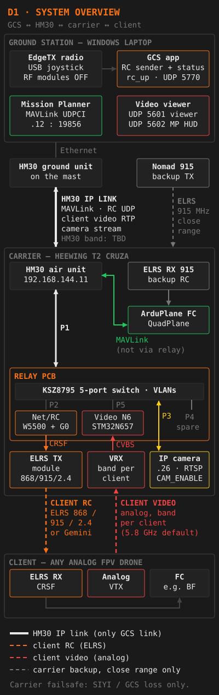

# VTOL relay suite — operations manual, flight tools, coverage map and GCS app

Field software for a **VTOL FPV relay system**:

- **Carrier:** a Heewing T2 **Cruza** VTOL (3 motors: M1/M2 tilt, M4 tail lift) running ArduPlane QuadPlane.
- **Relay:** a two-board PCB on the carrier. The **video board** (STM32N657) turns the client's analog video
  (PAL or NTSC) into H.264 over RTP/UDP; the **net/RC board** (KSZ8795 switch, W5500 + STM32G030 bridge) turns RC
  packets from the ground into CRSF for an ELRS TX module (any band) and switches the carrier's IP camera.
- **Client:** any analog FPV drone, flown from the ground station through the relay.
- **Links:** the SIYI HM30 is the only ground ↔ carrier link (Mission Planner MAVLink, RC, video, camera). A 915 MHz
  Nomad is the carrier's close-range backup only — **the carrier fails safe only when the SIYI/GCS link is lost.**
- **Ground station:** a Windows laptop with Mission Planner and the **GCS companion app** from this repository.

**Live site:** https://melonno.github.io/vtol-manual/ — works offline after the first visit and installs to a phone's
home screen.

## The pages

| Page | Path | Purpose |
|---|---|---|
| **Flight Tools** | [`index.html`](index.html) | Pre-flight, turnaround and post-flight checklists (6 h expiry, challenge–response mode), emergency cards, live **Link** status from the GCS app, battery log per pack, `.tlog`/`.bin` and GCS session-log analysis, flight records and maintenance, parameter-file import and comparison, weather with wind at relay altitude, client/pack/link profiles |
| **Emergency only** | [`index.html#emergency-only`](index.html#emergency-only) | Large-button phone mode: one scenario per tap, immediate actions only |
| **Operations Manual** | [`manual.html`](manual.html) | Aircraft, flight modes and failsafes, relay electronics, client drones, procedures, mission planning, crew training, maintenance, RF & comms, pre-arm reference, the full **parameter reference**, emergency procedures. Deep links: `manual.html#<tab>` or `#<tab>/<anchor>` |
| **Coverage map** | [`relay/map.html`](relay/map.html) | Video, RC and HM30 link coverage with terrain line of sight, Fresnel clearance and foliage loss; the video ∩ RC operating area; orbit sweep; mission playback; live carrier and client from the GCS app |
| **Latency clock** | [`tools/latency-clock.html`](tools/latency-clock.html) | Millisecond clock for the glass-to-glass latency test |

Every page shows the app version, the content date and the parameter file in its footer, and offers
**NEW VERSION AVAILABLE — RELOAD** when a newer version has been deployed.

## The GCS companion app (`gcs/`)

A Windows app (Python 3.12) that reads the FPV pilot's EdgeTX radio over USB and sends the RC stream to the relay's
bridge at 250 Hz, with interlocks and two start paths (**normal**, and **RESUME (client airborne)** after an app
failure). It shows the bridge state, round-trip time and client telemetry, raises the client alarms (FPV FAILSAFE,
LINK WEAK, BATT LOW, …), switches the carrier camera, fans the client video out to a viewer and the Mission Planner
HUD, shows the client in Mission Planner, and serves a read-only local API that the Link tab and the map use.
It never sends MAVLink to the carrier.

- User guide, configuration, interlocks and alarms: [`gcs/README.md`](gcs/README.md).
- Download: the `vtol-gcs-<version>-windows-x64.zip` attached to each
  [GitHub Release](https://github.com/MelonNO/vtol-manual/releases) (built by CI), or build it yourself with
  `gcs/packaging/build.ps1`.
- Relay UDP protocol (PROPOSAL, to be agreed with the bridge firmware): [`protocol/README.md`](protocol/README.md).

## Architecture



Diagram D1 ([`img/diagrams/d01-system-overview.svg`](img/diagrams/d01-system-overview.svg)); the manual has all 16
diagrams D1–D15 + D8b. Repository layout:

| Path | What it is |
|---|---|
| `index.html`, `manual.html`, `relay/map.html`, `tools/latency-clock.html` | The pages: static HTML/CSS/JS, no build step |
| `data/content.js` | **Single source** of the operational content: checklists, emergency cards, failsafe table, network table, callouts |
| `data/params-reference.js` | Generated from the reference parameter file (all 1663 parameters) |
| `js/` | Shared modules (browser + Node): data store, Tools logic, content renderers, diagrams, GCS-app client, field features; `js/vendor/` QR library |
| `relay/rfmodel.js`, `relay/vendor/leaflet/` | Coverage-map maths; vendored Leaflet 1.9.4 |
| `css/`, `fonts/`, `img/`, `icons/` | Shared styles (colour tokens in `css/base.css`), self-hosted fonts, photos and diagrams, app icons |
| `sw.js`, `sw-precache.js`, `manifest.webmanifest` | Offline service worker, its generated precache list, the web-app manifest |
| `gcs/` | The Windows GCS companion app, its tests, the bridge simulator and packaging |
| `protocol/` | Relay UDP protocol v1 spec and byte-exact test vectors |
| `scripts/` | Generators (precache, diagrams, parameter reference, icons), image optimiser, CI checks |
| `test/` | Node tests (`node --test test/`), including the jsdom page smoke tests in `test/smoke/` |
| `docs/` | Improvement plan, [parameter reference](docs/reference/README.md), [relay docs](docs/relay/README.md) (IP plan, firmware requests, open items, test results), work-package records, [historical notes](docs/history/README.md) |

### Parameter reference

The carrier's parameter export of 2026-10-17 is stored byte for byte as
[`docs/reference/carrier-params-2026-10-17.param`](docs/reference/carrier-params-2026-10-17.param). Every page uses it
offline: the manual's **Reference ▾ Parameters** tab lists all parameters, the Tools **Params** tab compares an
imported file against it, and the failsafe and battery values on every page follow it. A parameter file imported in
the Tools page takes precedence and is compared against the reference. How to update it:
[`docs/reference/README.md`](docs/reference/README.md).

### Open items

The relay hardware and firmware, the measurements and some owner decisions are not done yet; the pages show them as
amber **TBD** / **VERIFY**. The full list: [`docs/relay/OPEN-ITEMS.md`](docs/relay/OPEN-ITEMS.md); what the software
asks of the firmware: [`docs/relay/FIRMWARE-REQUESTS.md`](docs/relay/FIRMWARE-REQUESTS.md).

## Development

No build step: edit the files and open them in a browser. Serve the repository root so the service worker and the
shared store work:

```bash
git clone https://github.com/MelonNO/vtol-manual.git
cd vtol-manual
python -m http.server 8000          # then open http://localhost:8000/
```

After changing anything the field needs (a page, script, style, image or diagram), regenerate the precache list:
`node scripts/gen-precache.mjs` (a test fails while it is stale). Other generators: `scripts/diagrams/build.js`,
`scripts/gen-params-reference.mjs` — each has `--check`.

### Tests

```bash
node --test test/                                          # Node 24; no npm packages needed
VTOL_JSDOM=/path/to/node_modules/jsdom node --test test/   # also runs the jsdom tests and the page smoke tests
node scripts/check-links.mjs                               # internal links and assets
node scripts/check-images.mjs                              # image-size budget
node scripts/check-colours.mjs                             # no hard-coded colours in inline SVG
python -m pytest gcs protocol                              # Python 3.12 (+ pytest, pygame-ce)
```

jsdom and html-validate are never repository dependencies: install them outside the repository, for example
`npm install --prefix ../vtol-tools jsdom html-validate`.

### CI

- [`.github/workflows/ci.yml`](.github/workflows/ci.yml) (every push and pull request): the generated-file checks,
  Node tests without and with jsdom (no jsdom test may be skipped there), html-validate on every page (accepted rules
  and their reasons in [`.htmlvalidate.cjs`](.htmlvalidate.cjs)), link check, image budget, colour lint, the
  protocol tests on Linux, and the full GCS suite five times on Windows.
- [`.github/workflows/gcs-build.yml`](.github/workflows/gcs-build.yml) (pushes to `main`, `v*` tags, pull requests
  touching `gcs/` or `protocol/`): tests, PyInstaller build on `windows-latest`, the zip as a workflow artifact, and
  on a `v*` tag the zip attached to that GitHub Release.

Content changes follow the review checklist in [`CONTRIBUTING.md`](CONTRIBUTING.md). Project conventions for
contributors and AI assistants: [`CLAUDE.md`](CLAUDE.md). Changes per release: [`CHANGELOG.md`](CHANGELOG.md).

## Releases and rollback

GitHub Pages serves `main` (deploy from a branch, repository root; `.nojekyll` makes it serve every file as is).
Every push to `main` is live within about a minute, and the pages then offer **RELOAD** to anyone who has them open
or cached. **Stable states are tagged and listed in `CHANGELOG.md`.** Never rewrite `main`'s history: no
`git reset --hard` + `git push --force` (plan REP-07).

### Tagging a release

```bash
# 1. js/version.js: set app to the release version (e.g. '2.0.0'); update the content date if content changed
node scripts/gen-precache.mjs && node --test test/      # 2. regenerate, test, commit, push to main
git tag -a v2.0.0 -m "v2.0.0 — short description"       # 3. tag the commit on main
git push origin v2.0.0
```

The GCS build workflow then builds the Windows app and attaches `vtol-gcs-v2.0.0-windows-x64.zip` to the release
(it creates the release if it does not exist yet; edit the notes from `CHANGELOG.md`, or create the release first
with `gh release create v2.0.0 --notes-file <notes>`).

### Rolling back

Roll back **forward**, with a new commit, so every clone and the history stay intact:

```bash
# Undo one bad commit (a merge commit needs -m 1)
git revert <commit>
git push origin main

# Redeploy a tagged release: make main's files exactly those of the tag, as one new commit
git checkout main
git restore --source=v2.0.0 --staged --worktree -- .
git commit -m "Roll back to v2.0.0"
git push origin main
```

Pages redeploys the rolled-back state like any other push, and the pages' RELOAD prompt brings phones and laptops
onto it. To return to the newer state later, revert the rollback commit.

To look at an old release without changing anything: `git checkout v2.0.0` (detached HEAD), or browse the tag on
GitHub.
