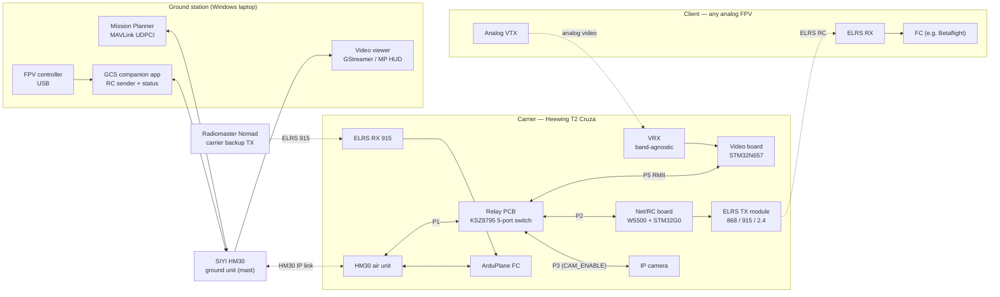
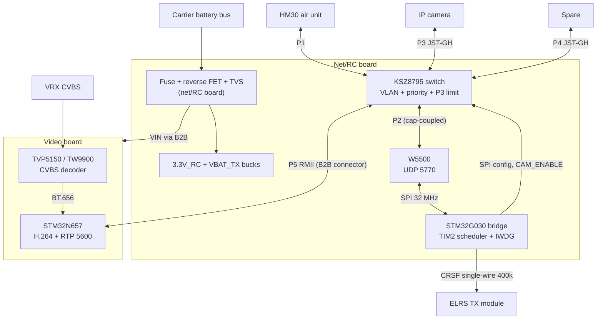
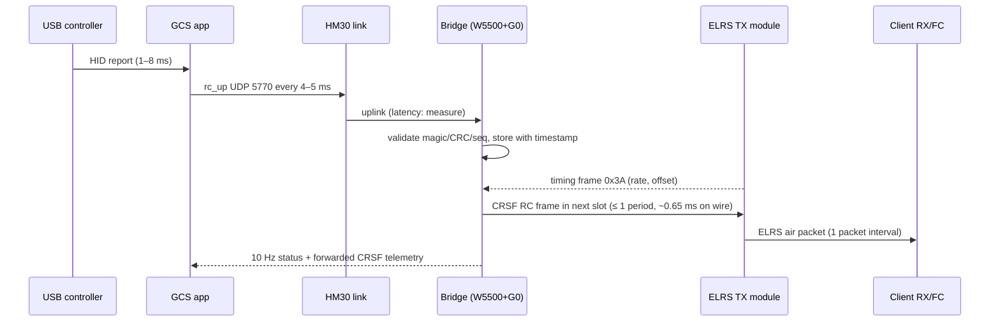
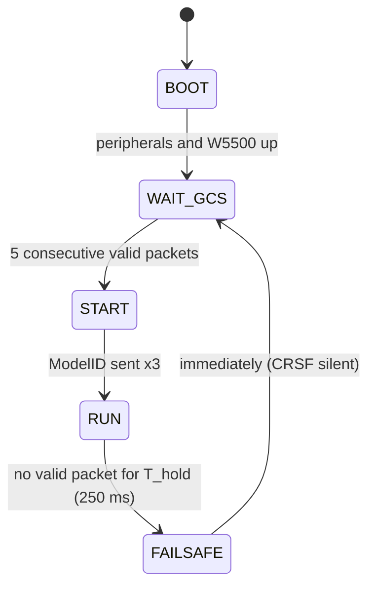
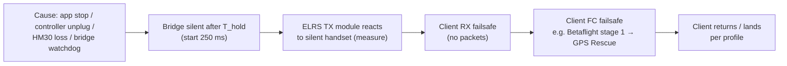

# VTOL Relay Suite — Software Review & Improvement Plan

| | |
|---|---|
| **Document** | SOFTWARE-IMPROVEMENT-PLAN · Rev A · 2026-10-16 |
| **Scope** | `index.html`, `manual.html`, `relay/map.html`, `relay/app.py` + template, `sw.js`, `scripts/`, `img/`, project docs |
| **Baseline** | commit `7376503` on `main` |
| **Input** | *Analog Video to IP Relay with Drone TX Control — Technical Solution* (dated 2026-10-14, **latest revision received 2026-10-16**: KSZ8795 5-port switch, camera port P3, CAM_ENABLE, 6–26 V supply, any-band ELRS/VRX), called "the relay design" below |
| **Status** | Review and proposal only. **No software has been changed.** |
| **Rev B** (2026-10-16) | Owner answers incorporated: the carrier failsafe philosophy (§4), TX modules, controllers, PAL+NTSC, repo layout, camera gating. Relay-design fixes confirmed (§3.4). New research section on client telemetry (§14). |

---

## Contents

1. [How to read this document](#1-how-to-read-this-document)
2. [Executive summary](#2-executive-summary)
3. [Target system — the new relay as implemented](#3-target-system--the-new-relay-as-implemented)
4. [Safety-critical findings (fix first)](#4-safety-critical-findings-fix-first)
5. [Bug catalogue by file](#5-bug-catalogue-by-file)
6. [Changes required by the new relay method](#6-changes-required-by-the-new-relay-method)
7. [New component: Windows GCS companion app](#7-new-component-windows-gcs-companion-app)
8. [Coverage map: new link model](#8-coverage-map-new-link-model)
9. [Illustrations and images](#9-illustrations-and-images)
10. [Other improvements](#10-other-improvements)
11. [Roadmap](#11-roadmap)
12. [Open questions](#12-open-questions)
13. [Appendices](#13-appendices)
14. [Research: new possibilities from the relay](#14-research-new-possibilities-from-the-relay)

---

## 1. How to read this document

### 1.1 Decisions this plan is built on

These came from the project owner during the review:

| Topic | Decision |
|---|---|
| Relay electronics | The old relay chain is **removed**: ground Nomad 868 MHz relay TX, DBR4, carrier Nomad relay TX, CVBS→HDMI converter, SIYI HDMI→IP encoder. The carrier is currently a normal SIYI HM30 installation. The two-board relay from the relay design will replace the old chain. **This document is written as if that design is implemented.** |
| RC band to the client | **Any ELRS band** (868 / 915 / 2.4 GHz). The relay's CRSF port drives whatever ELRS TX module is fitted. Docs, checklists and the map treat the band as a setting. |
| Video receiver | The final VRX will be **frequency agnostic**. The video band is a setting too, with 5.8 GHz as the default. |
| VRX antennas | **Same dual patches**, facing inward, as the map models today. |
| Carrier camera | An **IP (Ethernet) camera**, routed **through the relay PCB**. The updated relay design does this: switch port **P3**, a spare port **P4**, and camera on/off from the GCS (`CAM_ENABLE`). See §3.4. |
| Ground station | **Windows only.** Mission Planner stays. The Linux GStreamer receiver and RC sender in the relay design have to be ported to Windows. |
| Carrier backup link | The **915 MHz Radiomaster Nomad → ELRS RX → ArduPlane** backup link **stays**. |
| **Carrier failsafe philosophy** | The SIYI HM30 is the primary link and stands in for "any IP radio". The direct 915 MHz RC link is **backup control at close range only**, and losing it out of range is expected and harmless. **The carrier must failsafe only when the SIYI link is lost.** So `THR_FAILSAFE = 2` (no RC failsafe action) is **intentional**, and `FS_GCS_ENABL = 2` (active in all modes) matches the intent. The *documentation* is what's wrong (§4). |
| Airframes | The carrier is the **Heewing T2 Cruza** VTOL. The client is **any analog FPV drone**. The Betaflight/Matek quad becomes one example "client profile", not *the* sub-drone. |
| ELRS TX module on the relay | **RadioMaster Nomad** (dual LR1121, 2.4 GHz + 868/900 MHz, Gemini) **or** a **RadioMaster DBR4 flashed as a TX** (see §14.6 for the caveats). |
| FPV pilot's controller | **RadioMaster EdgeTX radios** (TX16S, TX15, Boxer, …) connected to the GCS laptop over USB (§7.3). |
| Flask app | **Retire `relay/app.py`** and replace it with a Windows GCS companion app (§7). |
| GCS app location | **This repo**, in `gcs/`, with the shared packet definitions in `protocol/` (§7, decision record in §12). |
| Video standard | **Both PAL and NTSC** must be supported, at runtime, per client. |
| Operational authorisation | Remote piloting through the relay **is covered** by the operator's authorisation (Luftfartstilsynet). Radio-spectrum rules (Nkom) are a separate question (§6.1.3). |
| Camera gating | Switching the carrier camera off is **only needed while a client drone is connected**. Carrier-only flights should have the camera available without the client RC stream (§3.4, firmware request). |
| This document | Lives in `docs/` and is committed to `main`. |

### 1.2 Labels

- **Severity** (bugs): **CRIT** = wrong safety information or could cause a mishap · **HIGH** = wrong results or data loss · **MED** = clear defect with a workaround · **LOW** = cosmetic or edge case.
- **Priority** (changes): **P0** before next flight · **P1** before first flight with the new relay · **P2** soon after · **P3** nice to have.
- **Effort**: **S** < ½ day · **M** ½–2 days · **L** > 2 days.
- Line numbers are from commit `7376503`.

---

## 2. Executive summary

**The software is in good shape for a hand-built, no-build-step field tool.** The checklist UX, battery analysis, log parsers, weather go/no-go and terrain-aware coverage map are well beyond typical hobby tools. The main problems are **content accuracy**, **stale relay architecture**, and **a few real code bugs**.

**Top findings**

1. **The documentation describes the opposite of the intended failsafe design (CRIT, documentation only).** The intent is that the carrier fails safe **only on SIYI (GCS) link loss**, and the 915 MHz link is close-range backup whose loss is harmless. The parameters already do that (`THR_FAILSAFE = 2` → no RC failsafe action; `FS_GCS_ENABL = 2` → GCS failsafe in all modes). But the manual, both emergency cards and the failsafe timeline graphic teach pilots that 915 MHz loss triggers FBWA → RTL, and that the GCS failsafe works only in AUTO. A pilot trained on the current text will expect the wrong behaviour in both directions.
2. **A few things the intended design depends on are undocumented (HIGH).** Mission Planner must stay running and sending heartbeats for the whole flight; closing it or letting the laptop sleep triggers RTL after 5 s. No other program may impersonate the primary GCS. QHOVER behaviour when the 915 link drops during a close-in manual takeoff or landing is untested. See S-01/S-02.
3. **The whole relay description is obsolete.** Chain diagrams, frequency table, network table, checklists, emergency cards, crew training, maintenance and the orbit diagram all describe the removed Nomad/DBR4/HDMI chain (§6).
4. **The aircraft is described as 4-motor and "T2 Ranger" in several places.** It is a 3-motor T2 Cruza (§5.2, MAN-05/11).
5. **The battery "margin" shown in the Tools page is wrong by roughly 3.6 V (HIGH).** It is measured from the chemistry floor (18.6 V), not from `BATT_CRT_VOLT` (22.2 V) (IDX-01).
6. **Checklist ticks never expire (HIGH).** Yesterday's GO banner can still be showing today (IDX-02).
7. **Cloud sync can silently delete data (HIGH).** It overwrites local data with the remote copy instead of merging, and the battery log is not exported or synced at all (IDX-03/04).
8. **The coverage map can't play back the project's own mission template (HIGH).** It ignores `VTOL_TAKEOFF`, `LOITER_TO_ALT` and `VTOL_LAND`. It also can't model the client's real 25 mW VTX: the slider starts at 100 mW (MAP-01/02).
9. **The offline promise is only partly true.** Leaflet, fonts and the map page are never cached by the service worker (SW-01, MAP-06).
10. **The new relay brings a big capability jump the software should use (researched in §14).** The bridge forwards CRSF telemetry from the client. For a Betaflight client that is uplink/downlink RSSI, LQ and SNR, GPS position, speed, altitude and satellites, battery voltage, current and mAh, attitude, and the flight-mode string including `!FS!` for failsafe. The GCS can then:
    - show live client status, and put the client on the map and in Mission Planner
    - raise automatic "relay edge" and "client failsafe" alarms
    - change the client's VTX channel *and* the relay VRX channel together, via ELRS VTX Admin and the backpack
    - build measured coverage maps

    This closes the documented gap that the "Carrier Pilot has no telemetry visibility of the FPV".
11. **The carrier camera is now switched from the GCS RC stream (`CAM_ENABLE`).** In the relay design it is off at power-up and forced off whenever the GCS stream is lost. Procedures, checklists, the emergency cards and the GCS app must all reflect this. Since gating is only needed while a client is connected, §3.4 proposes a small firmware change so the camera is available on carrier-only flights.

**Recommended order:** fix the safety content (§4) → fix the code bugs (§5) → rewrite the content for the new relay (§6) → build the GCS companion (§7) → upgrade the map (§8) → graphics and the rest (§9–10).

---

## 3. Target system — the new relay as implemented

### 3.1 System overview



### 3.2 Links

| Link | From → To | Medium | Carries | Replaces |
|---|---|---|---|---|
| GCS IP link | HM30 ground ↔ HM30 air | SIYI HM30 | MAVLink, RC UDP, N6 video RTP, IP camera stream | — (unchanged, now carries more) |
| Client video | Client VTX → carrier VRX | Analog, **any band** (5.8 GHz default) | CVBS PAL/NTSC | 5.8 GHz only |
| Client RC | Carrier ELRS TX module → client ELRS RX | ELRS **868 / 915 / 2.4 GHz** | CRSF RC, plus telemetry back | Ground Nomad 868 → DBR4 → carrier Nomad 2.4 |
| Carrier backup | Nomad → ELRS RX on FC | ELRS 915 MHz | RC to ArduPlane | — (unchanged) |

### 3.3 Network and port map (proposed — confirm before flight)

| Device | IP | Port / protocol | Direction | Notes |
|---|---|---|---|---|
| Laptop | `192.168.144.X` / 24 | — | — | Static IP. **X must not clash** with any address below. Suggest `.100`. |
| HM30 air unit | `192.168.144.11` | — | — | Unchanged |
| HM30 ground unit | `192.168.144.12` | UDP 19856 (MAVLink) | ↔ | Unchanged; Mission Planner UDPCI |
| IP camera | `192.168.144.26` (current) | RTSP 8554 `/main.264` | camera → GCS | Via relay switch **P3**. VLAN: reaches only P1. Ingress rate-limited. **Only passes traffic while `CAM_ENABLE` = 1** in the GCS RC stream. |
| Spare port | — | — | — | Switch **P4** (JST-GH). VLAN: reaches only P1. Document what may be connected (e.g. a companion computer) and its bandwidth cap. |
| N6 video board | **TBD** (e.g. `.20`) | RTP/UDP **5600** at the GCS | carrier → GCS | Destination IP and port stored in N6 flash |
| RC bridge (W5500) | **TBD** (e.g. `.21`) | UDP **5770** at the bridge | GCS → carrier (RC), carrier → GCS (status + CRSF telemetry) | 36-byte `rc_up` packets at 200–250 Hz |
| ~~FPV video RTSP~~ | ~~`192.168.144.25`~~ | — | — | **Removed** (was the SIYI HDMI→IP encoder) |

> **Port conflict to plan for:** only one Windows process can normally bind UDP 5600. If Mission Planner's HUD *and* a standalone viewer both want the client video, the N6 must send to two ports or a multicast group, or the GCS app must re-broadcast. See §7.4.

### 3.4 Hardware items that affect the software and docs

These are outside the software, but the manual has to describe them correctly:

1. **Switch and camera port (resolved in the updated relay design).** A KSZ8795CLXIC 5-port switch: **P1** HM30, **P2** W5500 (RC bridge), **P3** IP camera, **P4** spare, **P5** RMII to the N6. The G0 configures it over SPI at boot and after any switch reset:
   - **VLANs:** P2 talks only to P1, and P3/P4 talk only to P1 (and P5 if needed). Camera and spare traffic, including broadcasts, never reach the RC bridge.
   - **P1 egress priority:** RC status → client video → camera.
   - **P3 ingress rate limit.**
   - **Camera on/off** via `CAM_ENABLE` (bit 0 of `rc_up.flags`). It is applied within one packet, **default off at power-up**, **forced off if the GCS stream is lost**, and its state is reported in the 10 Hz status packet. The camera stays powered, so it resumes at once.

   The relay design itself points out that the switch priorities only order packets on the cable, while the **HM30 radio is the bottleneck**. That is why the camera is switched off while flying FPV.

   Software impact:
   - the GCS app needs a camera toggle and status (§7.5)
   - procedures and checklists need camera-state steps (§6.1.6, §6.2.1)
   - the emergency cards change (§6.1.8)
   - the manual needs a bandwidth-budget section (§6.1.4)
2. **Relay-design fixes confirmed in the latest revision.** Every inconsistency raised in Rev A of this plan is fixed:
   - supply now **6–26 V** (2S–6S, full 6S = 25.2 V)
   - the pin map and bring-up checklist use **P5** for the N6
   - NRST ESD part consistently **ESDZL5-1F4**
   - ELRS module "**any band**", VRX "**band per client**"
   - optional **50 MHz oscillator** footprint added for the unverified KSZ8795 RMII-clock case
   - bridge MCU consistently **STM32G030**
   - the G0 **reads back** the switch registers and reports the *actual* camera state

   What is still open: the KSZ8795 register names (taken from the KS8995 family) and the RMII clock direction. Both need confirming in the datasheet; they affect the GCS camera status display and diagram D2.
3. **Firmware request — camera gating only while a client is connected** (owner decision, Q12). In the current relay design the camera is off at power-up and stays off until a GCS RC stream sets `CAM_ENABLE`, so a **carrier-only** flight has no camera unless the GCS app runs. Proposed G0 behaviour:

   | Bridge situation | Camera (P3) |
   |---|---|
   | No valid GCS RC stream since boot (carrier-only, client not connected) | **ON** (at its P3 ingress cap) |
   | RC stream running | follows `CAM_ENABLE` (app default: off while the client is armed) |
   | RC stream lost after having run (client in failsafe) | **OFF** — protect the client's video during its RTH, as in the relay design |
   | New stream after loss | follows `CAM_ENABLE` again |

   Alternative without firmware change: an app "Carrier-only mode" that streams RC with the arm channel forced to disarmed and `CAM_ENABLE = 1`. This works, but needs the app running and an ELRS TX module that transmits to nobody. **Recommendation: the firmware change.**
4. **ELRS TX module power (VBAT_TX).** Retail specifications for the **RadioMaster Nomad** list:
   - 2 × LR1121, up to 1 W per band
   - XT30 input **6–16.8 V**, with outputs above 250 mW requiring the XT30 supply (2S–4S)
   - an ESP32 main MCU plus an ESP32-C3 (the TX backpack)

   The relay design's VBAT_TX buck must therefore output a voltage **inside 6–16.8 V**, with peak current sized for dual-band 1 W operation (from the RadioMaster datasheet or a measurement). A DBR4 used as a TX has different supply needs and much lower output power (§14.6). The manual's power table must list the module actually fitted.

---

## 4. Safety-critical findings (fix first)

All of these are **content** fixes in `manual.html` and `index.html`. They are P0 regardless of the relay change. **No parameter change is needed for S-01/S-02**: the aircraft is configured as intended, and only the documentation and procedures are wrong.

**Design intent (to state at the top of the manual's Flight Modes chapter):**

> The SIYI HM30 link (Mission Planner) is the **primary control link** and the **only link whose loss triggers a carrier failsafe**. The 915 MHz Nomad link is **close-range backup control** (takeoff, landing, or HM30 trouble near the field). Losing it beyond close range is **expected and requires no action**; the aircraft ignores RC while it is absent.

| ID | Finding | Evidence | Where it appears | Fix |
|---|---|---|---|---|
| **S-01** | The docs say losing the 915 MHz link triggers FBWA (1.5 s) → RTL (5 s). By design, it triggers **nothing**. | `THR_FAILSAFE=2`: *"…the RC inputs won't be used when RC failsafe is detected… but it won't trigger an RC failsafe action."* This is the intended behaviour. | Manual Flight Modes failsafe table and SVG timeline (`manual.html:386-455`); Emergency "RC Link Loss" in both files (`manual.html:757-776`, `index.html:223-242`); checklist D "Failsafe params" note (`index.html:584`); glossary FBWA entry (`manual.html:964`); header meta of both pages | (1) Rewrite the failsafe table from the design intent above. (2) Replace the 915 MHz "RC Link Loss" **emergency** card with a short **"Backup link lost"** note: *beyond close range: expected, no action; during a close-in manual phase: switch to Mission Planner control.* (3) Redraw the timeline for the **SIYI failsafe** (S-02). (4) Fix the checklist copy-block comments. |
| **S-01a** | Unverified behaviour: what the aircraft does if the 915 link drops **while the pilot is flying it with the Nomad** (QHOVER takeoff/landing). With `THR_FAILSAFE=2` the RC input is ignored; whether QHOVER then holds altitude and position or drifts has not been tested. | ArduPlane ignores RC on RC failsafe with value 2; the resulting Q-mode behaviour is not documented in the manual. | Procedures (takeoff/landing), Emergency | **Bench test, props off:** QHOVER, armed (or in the simulator, SITL), switch the Nomad off and record what MP shows (mode, throttle and attitude targets). Document the result and the pilot action ("take over in MP: QLOITER/QLAND"). |
| **S-02** | The GCS (SIYI) failsafe is active in **all modes**, not just AUTO as documented. This is what the intent needs. | `FS_GCS_ENABL`: *0 Disabled, 1 Heartbeat, 2 HeartbeatAndREMRSSI, 3 HeartbeatAndAUTO*. It triggers after `FS_LONG_TIMEOUT` (5 s) and runs `FS_LONG_ACTN` (1 = RTL). | Flight Modes table row "GCS (SIYI) loss — AUTO only"; Emergency "GCS Link Loss" steps 3–4; checklist copy block `FS_GCS_ENABL = 2 (GCS failsafe in AUTO only)` | Correct the meaning everywhere. Rewrite the GCS-loss card: *"SIYI lost > 5 s → RTL in any mode. Use the Nomad only if within close range."* Document what RTL does when triggered **in a Q-mode** (check `Q_RTL_MODE` / `Q_OPTIONS` in the param file, then test in SITL). |
| **S-02a** | Mission Planner **is** the heartbeat. If MP is closed or crashes, or the laptop sleeps or hibernates, or the Ethernet cable is pulled, the carrier sees "GCS lost" and RTLs after 5 s. That is correct behaviour, but it is not in any procedure. | `FS_GCS_ENABL` tracks heartbeats from the primary GCS (`MAV_GCS_SYSID`). | Procedures, checklist C, Emergency | Add: *"Never close MP in flight. Laptop on mains or a sleep-proof power plan."* Add a checklist item "Laptop sleep/hibernate disabled". |
| **S-02b** | No other program may send GCS heartbeats as the **primary GCS sysid**. Doing so would keep the carrier "happy" even when MP (the real control path) is dead. Today's `relay/app.py` sends from `source_system=255`, the same id MP uses by default. | `app.py:539-540`; ArduPlane heartbeat tracking of `MAV_GCS_SYSID`. | Flask app (retiring), future GCS app | The GCS companion app must **never** send carrier-bound MAVLink as sysid 255. Ideally it sends no carrier MAVLink at all, or uses a distinct sysid and is read-only (§7, §14.4). |
| **S-02c** | `FS_GCS_ENABL = 2` also fails safe when an HM30 `RADIO_STATUS` reports `remrssi = 0`. Whether the HM30 sends `RADIO_STATUS` at all is unknown (Q2). If it does not, value 2 behaves like 1 (heartbeat only). Either is consistent with the intent. | Parameter description. | Manual Flight Modes | Check with the MAVLink Inspector in MP (Ctrl-F → MAVLink Inspector) and document the result. |
| **S-03** | `FS_SHORT_ACTN=0` is documented as FBWA. | Value 0 = *"CIRCLE / no change (if already in AUTO, GUIDED, LOITER)"*; FBWA is 2. Only reachable via an RC failsafe, which is disabled by design. | Same places as S-01 | Remove the FS_SHORT/FS_LONG "RC timeline" from the docs. Keep `FS_LONG_ACTN=1` and `FS_LONG_TIMEOUT=5` **as the GCS-failsafe action and delay**, which is what they control here. |
| **S-04** | Altitudes are called "AGL" when they are relative to **home**. | `RTL_ALTITUDE`: *"Target altitude above home"*. Mission altitudes are relative to home unless the terrain frame is used. | Header meta "RTL ALT 120m AGL" (both pages), Overview stat boxes, Flight Modes, emergency steps, Mission Planning "All altitudes relative to home (AGL)" | Use "REL (above home)" consistently. Add a note: over rising terrain, REL ≠ AGL. Consider terrain-frame waypoints for relay orbits. |
| **S-05** | The battery-margin text understates the risk. | `index.html:854` computes margin to `chem.critical × cells` (18.6 V for 6S). The text says *"… extra above the emergency threshold"*. | Battery Log → Recommended BATT_LOW_VOLT card | Measure the margin to `BATT_CRT_VOLT` (22.2 V; make it configurable). |
| **S-06** | Checklist ticks persist forever. | `vtol_cl2`/`vtol_cl3` are stored with no timestamp. | Pre-Flight, Turnaround | See IDX-02. |
| **S-07** | The motor count and airframe are wrong in procedures. | "All 4 motors spool" (`manual.html:719`), "Cruise motor spools" (`:727`, `:696`), "Props (all 4)". | Procedures, Transition table, Maintenance, checklist B | 3 motors (M1/M2 tilt + M4 tail), no separate cruise motor. |
| **S-08** | Transition-direction advice contradicts itself. | "Crosswind or slightly downwind is the preferred corridor… a tailwind transition requires more airspeed margin" (`manual.html:1584`). | Mission Planning → Transition Planning | State a single rule: transition **into wind** (airspeed builds fastest). Avoid tailwind. |

---

## 5. Bug catalogue by file

### 5.1 `index.html` — Flight Tools

| ID | Sev | Location | Problem | Fix |
|---|---|---|---|---|
| IDX-01 | HIGH | `:851-898` | `marginV = recRaw − chem.critical·cells` → "4.4 V above critical (18.6 V)" for a 23.0 V recommendation. The operational floor is 22.2 V (0.8 V margin). | Add a `BATT_CRT` input (default 22.2) and compute the margin against it. Show both the chemistry and the operational floor. |
| IDX-02 | HIGH | `:622-652`, `:665-667` | Checklist state is stored with no session or time. GO persists across days and power cycles. | Store `{checked, ts}` per item plus a session id. Auto-reset after N hours (e.g. 6 h) or on START TIMER. Show "checked 14:02" in the detail pane. |
| IDX-03 | HIGH | `:1108-1118`, `:1167-1173`, `:1059-1062` | `vtolCloudPull()` **replaces** the local archive and favourites with the remote copy. SYNC NOW and app start both pull before push, so entries created offline (push failed) are lost. | Merge by stable id (`uuid` + `updatedAt`), with tombstones for deletes. Push after merge. |
| IDX-04 | MED | `:937`, `:964-1050` | `vtolData` holds only `archive` and `weatherFavorites`. The **battery log** (`vtol_battlog`), battery type and checklist history are not exported, imported, file-linked or synced. | Put all persistent data in one versioned store (`schemaVersion`). Include the battery log. |
| IDX-05 | MED | `:2110` | `hourly.time.indexOf(current.time)`: Open-Meteo "current" times are 15-minute aligned (`…T18:15`), hourly ones are `…T18:00`. When not on the hour, `hIdx = 0` (midnight), so the icing table and the 4-hour forecast show the wrong hours. | Find the hourly index with `floor` to the hour, or pick the nearest time ≤ now. |
| IDX-06 | MED | `:1789-2002` | Dead code: `parseTlogFull()`/`renderTlogResult()` use DOM ids that don't exist (`tlog-full-*`) and undefined globals `PLANE_MODES`, `SEV_COLOR`, `SEV_LABEL`. `rf32le` is labelled a "placeholder" but is used. | Delete it, or wire it up properly (a richer .tlog view is useful — §10.4). |
| IDX-07 | MED | `:827`, `:867`, `:1255`, `:1320`, `:1733`, `:1777`, `:2252` | Untrusted strings go into `innerHTML` without escaping: battery notes/flight name, archive notes, favourite names (also via import/Gist), .bin `MSG` text, filenames, Nominatim place names. This allows XSS, and the page keeps a GitHub token in localStorage. | Add an `escH()` helper (already exists in manual.html) or use `textContent`. Add a CSP `<meta>`. |
| IDX-08 | MED | `:757`, `:826`, `:851`, `:891`, `:1451` | The cell/chemistry selector exists, but 6S values are hard-coded: 23.0 V RTL line and floor, 22.8 V storage row, 22.5/23.0 colouring, .tlog 18–30 V filter. With a 4S or LiFe client pack the analysis is nonsense. | Make the thresholds per pack profile (§10.3). |
| IDX-09 | LOW | `:2311-2329` | Swipe-to-change-tab is active while the emergency modal is open and on horizontally scrolling tables (battery log). It causes accidental tab changes. | Ignore swipes when the modal is open or the touch started inside a scrollable element. |
| IDX-10 | LOW | `:823` vs `:860` | The battery table is built twice; the first build is thrown away. | Remove the first build. |
| IDX-11 | LOW | `:1391-1471` | .tlog parser: MAVLink 2 **signed** frames (incompat flag 0x01, +13 bytes) misalign parsing. Duration includes ground time. The date uses UTC `toISOString` (can be off by a day). | Handle signing. Compute armed time from HEARTBEAT `base_mode`. Use local date. |
| IDX-12 | LOW | `:1520`, `:1680`, `:1650` | .bin: `POS.RelHomeAlt` is labelled "true AGL" (it is relative to home). GPS week→UTC ignores leap seconds (~18 s). Multiple `BAT` instances are mixed together. | Fix the labels, subtract leap seconds, filter on `Inst`. |
| IDX-13 | LOW | `:692-698` | `navigator.clipboard.writeText` has no `.catch` and fails silently (permission or non-secure context). | Catch, then fall back to `execCommand('copy')` or select-text. |
| IDX-14 | LOW | `:633` | Saved state is keyed by item index (`A-3`). Inserting an item in code moves ticks onto the wrong items. | Give each checklist item a stable `id`. |
| IDX-15 | LOW | `:2028-2063` | Sun times: day-of-year is local, the date is built in UTC, and UT wrap-around can land on the wrong day. Fine in Norway; wrong elsewhere. | Use a tested routine (e.g. SunCalc, vendored). |
| IDX-16 | LOW | `:2298-2307` | On *any* error (including code errors) the cached weather for possibly **another location** is shown as "OFFLINE". | Only fall back on network errors. Show the cached location and age prominently. |
| IDX-17 | LOW | `:567`, `:190` | "all 4 motors", "RTL ALT 120m AGL". | See S-04/S-07. |
| IDX-18 | LOW | `:1597-1600`, `:1137` | `binChart` divides by zero when all timestamps are equal. The token is entered with `prompt()` (not masked). | Guard; use a password field. |
| IDX-19 | LOW | `:1339` | MP voltage fetch `http://localhost:20199/mavlink/SYS_STATUS`: the endpoint is unverified, and Chromium "Private Network Access" rules may block https→localhost requests. | Verify with the current Mission Planner. Better: read voltage from the GCS companion app (§7.6), which sends the right CORS/PNA headers. |

### 5.2 `manual.html` — Operations Manual

| ID | Sev | Location | Problem | Fix |
|---|---|---|---|---|
| MAN-01 | CRIT | see S-01 | Documents an RC failsafe cascade that is disabled by design | S-01 (docs only) |
| MAN-02 | CRIT | see S-02 | GCS failsafe documented as AUTO-only; it is all-mode (as intended) | S-02 (docs only) |
| MAN-03 | HIGH | `:389` | `FS_SHORT_ACTN=0` ≠ FBWA | S-03 |
| MAN-04 | HIGH | many | AGL vs REL | S-04 |
| MAN-05 | HIGH | `:466`, `:696`, `:719`, `:727`, `:1229-1230`, `:1255`, `:473` | "two rear motors", "cruise motor", "all 4". `Q_FRAME_CLASS=7` is shown only as "Frame class" — it means **Tri**. | Correct; label `7 = Tri`. |
| MAN-06 | MED | `:1584`, `:1346` vs `:728` | Transition direction contradictory; "no airspeed after **2 s**" (callouts) vs "**3 s**" (procedures). | Pick one rule and one number. |
| MAN-07 | MED | `:708-713` vs `:910` | Power-up says Nomad TX **last**; the pre-arm table says "Power TX **before** aircraft". "Reversing the sequence risks motor spin" is unsupported. | Decide on one order. With the new relay the order matters for the bridge too (§6.1.6). |
| MAN-08 | MED | `:1571`, `:1606` | "WP1 VTOL_TAKEOFF… sets the home point". ArduPilot sets home **at arming**. | Correct. |
| MAN-09 | MED | `:247`, `:1092`, `:1097-1098` vs `:277` | FPV described as 5" and as 7"+. FPV "full charge 24.6 V / 4.1 V" vs carrier 25.2 V. | Replace with a generic client profile (§6.1.7). |
| MAN-10 | LOW | `:1148`, `:1383` | "Stick input disables GPS Rescue mid-flight". While the link is lost, sticks can't reach the client; once the link returns, moving the sticks past the threshold is the *intended* way to take control back. | Reword: "When link returns, sticks above X % end the rescue — only do so deliberately." |
| MAN-11 | LOW | `:243`, `:552`, `:556`, `:1097`, `:343` | Captions: "T2 Ranger" (the image says **T2 Cruza**); "5-inch racing quadcopter"; unverified vendor specs ("1.2 m wingspan", "30 km, 1080p60"). | Correct; source the specs or remove them. |
| MAN-12 | LOW | `:1732-1743`, `:1666` | Search opens the tab but scrolls to the **top**, not to the match. No deep links (`#tab`). The last tab isn't remembered. Dropdowns close on any scroll (annoying with mobile momentum scroll). | Scroll to and highlight the match; support `location.hash`; persist the tab; close only on scroll > N px. |
| MAN-13 | LOW | `:906`, `:912`, `:951` | Generic pre-arm values (`ARSPD_TYPE=4`, "≥6 sats", "HDOP < 2.0") not checked against this aircraft's params. | Cross-check with the `.param` file; add a "verified against param file dated …" note. |
| MAN-14 | LOW | `:572-608` | The battery gauge lacks the 22.5 V hard limit and the 22.8 V storage marker. The "NORMAL" zone starts at 23.0 V, which is the RTL trigger. | Redraw (§9.2). |
| MAN-15 | LOW | header `:166` | "DOC-RC-001 · REV A" never changes. | Generate the revision and date from a constant bumped on release (§10.6). |

### 5.3 `relay/map.html` — Coverage map

| ID | Sev | Location | Problem | Fix |
|---|---|---|---|---|
| MAP-01 | HIGH | `:828-844` | Mission parser accepts only commands 16/22/21. `VTOL_TAKEOFF` (84), `VTOL_LAND` (85), `LOITER_TO_ALT` (31), `LOITER_TURNS` (18), `LOITER_UNLIM` (17) and `LOITER_TIME` (19) are skipped, so the manual's 7-WP template plays back as **3 points**. The altitude frame (column 3) is ignored, and only TAB separators work. | Accept all NAV commands that have coordinates. Simulate loiters (orbit for N turns or until altitude). Honour the frame (0 = AMSL, 3 = REL, 10 = terrain). Split on whitespace. |
| MAP-02 | HIGH | `:310`, `:449` | VTX slider is 20–33 dBm (100 mW–2 W), default 600 mW. The reference client runs **25 mW (14 dBm)**, which can't be selected. The boresight shows ≈3.6 km instead of ≈0.7 km. | Range 0–33 dBm. Default from the active client profile. |
| MAP-03 | MED | `:632-638` (and `app.py:142-145`) | **Pitch sign inverted.** For the stated convention (nose-up positive), body = Rx(φ)·Ry(θ)·Rz(ψ)·n needs `x2 = x1·cθ − z1·sθ`, `z2 = x1·sθ + z1·cθ`. The code has the opposite signs. Check: with θ = +10° and a level target ahead, the code puts the target *above* the nose. | Fix the signs; add a unit test with known vectors. |
| MAP-04 | MED | `:644-650` | `combinedRF()` uses the *entered* altitude as the height above the quad. In AMSL mode (e.g. 600 m) the depression angle is absurd; in REL mode it ignores terrain. | Per bearing, use `rAsl − (terrain + quadAlt)` at the evaluated distance. |
| MAP-05 | MED | `:652-680`, `:438` | Clearance is a fixed 25 m parabola, independent of frequency and distance. At 5.8 GHz over 3.6 km the first Fresnel radius at midpoint ≈ 6.8 m; at 868 MHz ≈ 17.6 m. Sample spacing ≈ 240 m on a ≈76 m/px DEM, so ridges between samples are missed. | Clearance = `k × F1(d1, d2, f)` (k ≈ 0.6) + optional margin. Sample at DEM resolution (or adaptive). See §8. |
| MAP-06 | MED | `:7-8`, `sw.js:12` | Leaflet CSS/JS come from unpkg and `sw.js` never caches cross-origin requests. `map.html` is not precached. **The map does not load offline** unless the browser's HTTP cache still has Leaflet. | Vendor Leaflet into `relay/vendor/`; precache it. |
| MAP-07 | MED | `:854-856` | `URL.createObjectURL(blob)` for cached tiles is never revoked, so memory leaks while panning. | Revoke in `onload`/`onerror`. |
| MAP-08 | MED | `:1824-1859` | Bulk download of OSM/OpenTopoMap/ESRI/Carto tiles probably breaks their tile-usage policies (OSM explicitly forbids bulk downloading). | Allow offline download only from sources that permit it (e.g. Kartverket open data — check the licence), or self-host tiles. |
| MAP-09 | MED | `:1889-1893` | **Privacy:** hard-coded default aircraft and GCS position (61.224 N, 10.768 E) in a public repo. GCS coverage is auto-computed on every load (heavy fetch: up to ~1 000 terrain samples + vegetation tiles). | Start empty or from geolocation/last used (localStorage). Compute on demand. |
| MAP-10 | LOW | `:1023-1027`, `:456-466` | The popup says "m AGL" whatever the altitude mode. "Rel" mode uses **GCS terrain** as home; ArduPlane home is where the carrier armed. | Correct the label; add an explicit "home" marker. |
| MAP-11 | LOW | `:1460-1470` vs `:1411` | Vegetation keys mismatch (`tx,ty` vs `tx/ty`), so the prefetch dedupe never hits. One transient failure on the first tile disables vegetation for the session. Any green pixel (fields, parks) counts as forest. | Use one key format; retry policy; restrict to the topo source's forest colour range, or use a land-cover dataset. |
| MAP-12 | LOW | `:1340-1365` | Dead diagnostics (`testApi`, `updateCacheInfo` → missing elements), interval still running. | Remove, or add a debug panel. |
| MAP-13 | LOW | `:754-757` | Polygon *and* GCS polygon recompute after **every** tile load, which janks slow phones. | Debounce (e.g. 150 ms). |
| MAP-14 | LOW | `:810-821`, `:239` | Mission sim jumps altitude at each WP. Sim speed minimum 9 m/s is below `AIRSPEED_MIN` 11. | Interpolate altitude; minimum = 11. |
| MAP-15 | LOW | `:206`, `:376`, `:429` | "5.8GHz RELAY COVERAGE", "patches face right" hard-coded. | Driven by the link profile (§8). |
| MAP-16 | LOW | `:1580-1587`, `:1692-1743` | GCS coverage applies **5.8 GHz** foliage attenuation to the HM30 link (not a 5.8 GHz link; check its band in the SIYI spec) and has no HM30 link budget, only geometry. | Per-link frequency and budget (§8). |

### 5.4 `relay/app.py` and `relay/templates/index.html` (to be retired)

Listed so that nothing is lost when the code is ported (§7). The same model errors as MAP-01/03/04/05, plus:

| ID | Sev | Location | Problem |
|---|---|---|---|
| APP-01 | MED | `:112-119` | `boresight_range(vtx_dbm)` ignores its argument (it is overwritten from `_state`). |
| APP-02 | MED | `:173` | `combined_range_factor()` uses the constant `QUAD_ALT`, not the `quad_alt` parameter. |
| APP-03 | MED | `:568-570` | `HEARTBEAT` from *any* component (e.g. a SIYI gimbal/camera) overwrites `flight_mode`. Filter on the autopilot sysid/compid and `MAV_TYPE`. `MODES` lacks GUIDED, CIRCLE, LOITER_QLAND, … |
| APP-04 | **HIGH** | `:539-540` | `udpout` to the same HM30 endpoint Mission Planner uses, **as `source_system=255`** — the same sysid as MP. If it were running while MP died, its heartbeats could mask the SIYI/GCS failsafe that the whole design relies on (S-02b). **Do not run `app.py` alongside a flight**; retire it. |
| APP-05 | LOW | `:313-314` | `relative_alt` (above home) is added to the terrain under the aircraft (treated as AGL). |
| APP-06 | LOW | `:813` | Flask on `0.0.0.0` with no auth; anyone on the network can move the "aircraft". |
| APP-07 | LOW | `:214-229` | Public OpenTopoData API: 1 req/s plus a daily cap (check the current limits). Not usable for real field work. |

### 5.5 `sw.js` — offline cache

| ID | Sev | Problem | Fix |
|---|---|---|---|
| SW-01 | MED | `if (url.origin !== self.location.origin) return;` means Google Fonts and Leaflet are never cached, although the comment says "cache-first for fonts". | Self-host fonts and Leaflet, or cache selected CDN hosts explicitly. |
| SW-02 | MED | Precache list = `./`, `index.html`, `manual.html`. Missing: `relay/map.html`, `img/*`, vendored libraries. Images in tabs never opened are not available offline. | Precache everything the field needs. |
| SW-03 | LOW | Cache-first for same-origin assets means changed images or JS never refresh until `CACHE` is bumped manually. | Use stale-while-revalidate, or content-hashed filenames. |
| SW-04 | LOW | No "new version available" prompt, so a crew can fly with stale procedures without knowing. | Show the app version in the footer; toast when a new SW is waiting; button to reload. |

### 5.6 Repository, scripts and project docs

| ID | Sev | Problem | Fix |
|---|---|---|---|
| REP-01 | MED | `scripts/watch-push.ps1` watches **its own folder** (`scripts/`), non-recursively, so it never sees edits to the pages. Setting `$watcher.Filter` in a loop leaves one filter (`*.*`). `git add .` auto-commits *anything* (risk of committing secrets). The debounce sleeps inside the event action. | Watch the repo root recursively with an explicit include list; stage only tracked/allow-listed paths; or drop auto-push in favour of deliberate commits. |
| REP-02 | LOW | `scripts/git-setup.ps1` rewrites `.gitignore` with 3 lines. Re-running it drops `token.txt`, `*.token`, `relay/.env`. | Append, don't overwrite; or delete the script (one-time use, done). |
| REP-03 | MED | `CLAUDE.md`, `ai/PROJECT_CONTEXT.txt`, `ai/SESSION_NOTES.txt` are stale: OpenTopoData (now AWS), cache `v4` (now `v10`), scripts in root (now `scripts/`), 4 motors, "return trigger 24 V", "emergency only in index", repo `vtol-Manual`. | Update after §6, then keep `CLAUDE.md` as the single source and archive the `ai/` notes. |
| REP-04 | LOW | `.claude/settings.local.json` (machine-local settings) is committed. | Add to `.gitignore`. |
| REP-05 | LOW | `ai/CONVERSATION_LOG.txt` (personal working notes) is public. | Move out of the public repo if not intended. |
| REP-06 | LOW | `archive/VTOL_Relay_Carrier_Operating_Manual.html` is still served by Pages, with outdated safety content. | Remove, or add an "OBSOLETE — DO NOT USE" banner and `noindex`. |
| REP-07 | LOW | README rollback recipe uses `git reset --hard` + `push --force` on `main`. | Prefer `git revert` or redeploying a tag. |
| REP-08 | LOW | `img/siyi_hm30.jpg` is actually a **PNG**. `img/fpv_drone.jpg` is 4.2 MB (4928×3264) with an **EXIF GPS block**. `img/t2_vtol.jpg` is 3.8 MB. | See §9.1. |

---

## 6. Changes required by the new relay method

### 6.1 `manual.html` — chapter by chapter

#### 6.1.1 Global

- **Terminology:** "FPV sub-drone" → **"client drone"** (or "client"). "Relay link" → **"RC uplink"** (GCS → client) and **"video downlink"** (client → GCS). "Relay Nomad"/"DBR4" → removed. New terms: *relay PCB*, *video board (N6)*, *net/RC board (bridge)*, *ELRS TX module*, *GCS companion app*.
- **Header strings:** `ELRS 915/868/2.4GHz` → `ELRS 915 (carrier) · ELRS <band> (client) · SIYI HM30`.
- **Glossary additions:** N6 (STM32N657), G0 (STM32G0 bridge), W5500, KSZ (switch), RMII, BT.656, CVBS, PAL/NTSC, field vs frame, H.264, RTP, RTSP vs RTP, SDP, CRSF frame, ModelID, timing frame (0x3A), T_hold, LQ, RSSI dBm, packet rate, binding phrase, model match, QoS / 802.1p.
- **Remove** 868 → 2.4 relay explanations everywhere, including "2.4 GHz has less diffraction margin than 868 MHz" (`:1417`), which becomes band-dependent guidance.

#### 6.1.2 Overview

- Mission sentence: *"…relays client video (analog VRX → H.264 over the HM30) and client RC (GCS → HM30 → relay bridge → ELRS TX module) …"*
- Crew table: the **FPV Pilot now flies from the GCS laptop with a USB controller** through the GCS companion app, watching the client video on the laptop (or HDMI goggles). Remove "FPV TX (2.4 GHz via relay) + MPV.net".
- **Replace** the alert "Carrier Pilot has no telemetry visibility of the FPV": with CRSF telemetry forwarded by the bridge, the GCS app can show client link quality, battery, GPS and mode, if the client sends telemetry. Keep the verbal callouts as the primary method until the telemetry path is proven.
- Photos: carrier = **T2 Cruza**; client = generic/your current client (§9.1).

#### 6.1.3 RF & Comms (rewrite)

1. **System diagram** (§3.1) replaces the three chain strips.
2. **RC uplink chain:** `USB controller → GCS app (rc_up @ 200–250 Hz, UDP 5770) → HM30 → relay switch → W5500 → G0 → CRSF 400 kbaud → ELRS TX module (<band>) → client ELRS RX → client FC`.
3. **Video downlink chain:** `client VTX (<band>, analog) → VRX → CVBS → TVP5150/TW9900 → N6 H.264 (per field, slice-handshake) → RTP/UDP 5600 → HM30 → GCS viewer`.
4. **Carrier camera chain:** `IP camera → relay switch P3 (VLAN to P1 only, rate-limited, gated by CAM_ENABLE) → HM30 → GCS (RTSP .26)`.
5. **Carrier backup link (915 MHz)** — unchanged, but with corrected failsafe text (S-01).
6. **Frequency table** built from the **active link profile**. Example rows: carrier backup 915; client RC `<868|915|2.4|Gemini>`; client video `<band/channel>`; HM30 `<HM30 band>`. Add a **co-site warning**: HM30, ELRS module and VRX share one airframe. The relay design's test 7 (co-site RF) result and the cleanest analog channel go here. Also note that the switch/W5500 25 MHz harmonics land near 5800 MHz and GPS L1 (from the relay design).
7. **Radio-spectrum compliance (Nkom), separate from the aviation authorisation.** Add a column "permitted in Norway (band / max power / duty cycle)" and **verify each row with Nkom's current regulations** before publishing:
   - the 915 MHz backup link (the Nomad retail spec lists FCC 903–927 MHz; Europe normally uses 868 MHz SRD rules)
   - the ELRS TX module power (up to 1 W per band on the Nomad)
   - 2.4 GHz power limits
   - the analog VTX bands and powers

   The ELRS regulatory-domain firmware (e.g. EU 868) should match. This plan does not assess legality; it flags that the manual currently says nothing about it.
8. **Network table** (§3.3), including the UDP 5600 single-listener note.
9. **Bandwidth budget** (new, §6.1.4).
10. **Latency budget** (new) from the relay design: video ≈ 20 ms in the relay + HM30 (est. 150–180 ms, unmeasured) + GCS decode 10–50 ms; RC ≤ one CRSF period in the relay + HM30 uplink (unknown) + one ELRS interval. Put **measured** values here once the relay design's tests 1, 2 and 6 are done.

#### 6.1.4 New chapter: Relay Electronics

Place it under **Aircraft ▾ → Relay Electronics**:

- **Block diagram** of the two boards and the 5-port switch (§9.3 D2).
- **What each board does** and the independence rule: the RC path never touches the N6, so the RC keeps running while video reboots or is reflashed. **VLAN isolation** also keeps camera and spare-port traffic (including broadcast storms) away from the RC bridge. Relay-design test 5 now includes flooding P3.
- **Switch configuration** as operated, from the G0: the VLAN map, P1 egress priorities (RC status → client video → camera), the P3 ingress limit value, and the camera on/off behaviour (`CAM_ENABLE`: default off, off on GCS-stream loss, state in the status packet).
- **Indicators** (operator-facing): N6 LEDs (heartbeat, decoder lock, Ethernet link — PG8/PG10/PG0). Bridge LEDs (RC state, link). **A table mapping LED patterns to bridge states** (BOOT / WAIT_GCS / START / RUN / FAILSAFE). The firmware must define these patterns; propose them here.
- **Connectors:** XT30 power; HM30 Ethernet (P1); camera Ethernet **JST-GH 4-pin TX+/TX−/RX+/RX− (P3)**; spare Ethernet JST-GH (P4); JST-GH CRSF (VBAT_TX, GND, CRSF, spare); CVBS (SMA + JST-GH); debug headers. A photo or drawing with labels. Note that the camera cable must be re-terminated to the JST-GH pinout.
- **Power:** input range (see §3.4 #2), measured consumption, effect on carrier endurance. **Rule:** never plug goggles in parallel with the relay on one VRX output (from the relay design).
- **Bandwidth budget:** the HM30's measured capacity split between N6 video CBR, IP-camera stream, RC uplink (≈100–130 kbit/s) and MAVLink. Two operating states:
  - **FPV mode** (camera off): N6 CBR + RC + MAVLink + margin ≤ HM30 capacity.
  - **Camera mode** (camera on): N6 CBR + camera cap (P3 ingress limit) + RC + MAVLink ≤ HM30 capacity. Relay-design test 9 must show FPV latency is unchanged with the camera on at its cap.

  If test 9 fails, the rule becomes "**camera off whenever the client is airborne**" and goes into the checklists and callouts.
- **Firmware versions:** where to read them (bridge status packet, N6 console), and a compatibility table (GCS app ↔ bridge protocol `ver`).
- **Bench test summary:** the relay design's acceptance tests **1–9** (9 = camera on/off) with pass criteria and *measured* results.

#### 6.1.5 Flight Modes

- Open with the **design-intent statement** (§4).
- Corrected failsafe table:

  | Event | Detection | Carrier action | Pilot action |
  |---|---|---|---|
  | **SIYI / Mission Planner link lost** | No GCS heartbeat for `FS_LONG_TIMEOUT` = 5 s (plus HM30 `remrssi = 0` if the HM30 reports it), **all modes** | `FS_LONG_ACTN` = 1 → **RTL** (Q-mode behaviour: per param file + SITL test) | Monitor; use the Nomad only if within close range |
  | 915 MHz backup link lost | ELRS RX failsafe | **None** — RC ignored (`THR_FAILSAFE` = 2) | None beyond close range; during manual phases, take over in MP (S-01a) |
  | Battery critical 22.2 V | `BATT_CRT_VOLT` | Loiter → QLand at current position | Clear the area below |
  | Battery low | `BATT_LOW_VOLT` = 0 (not set) | None | Manual RTL at 23.0 V |
  | Transition fail | `Q_TRANS_FAIL` 4 s | `Q_TRANS_FAIL_ACT` → QHOVER | Per emergency card |
- The SVG becomes a **SIYI-loss timeline**: 0 s link lost → 5 s RTL → climb to `RTL_ALTITUDE` (above home) → return → back-transition/land per Q settings.
- **New: client failsafe chain** (diagram §9.3 D6). GCS app stops sending, *or* the HM30 link is lost, *or* the bridge watchdog fires → the bridge goes silent after `T_hold` (start 250 ms) → the ELRS TX module stops sending (behaviour to be measured) → client RX failsafe → client FC failsafe (e.g. Betaflight stage 1 → GPS Rescue). **Total time = measured value from relay-design test 6**, per cause.
- **New: the relay never sends default sticks at boot.** The bridge waits for 5 valid packets before any CRSF.

#### 6.1.6 Procedures

**Power-up sequence (new order, to be confirmed by test):**

1. HM30 ground unit on (mast) → link LED.
2. Laptop: static IP verified → GCS companion app started → **controller connected; arm switch DISARMED; throttle low** (the app enforces this, §7.3).
3. Client drone powered → VTX on the planned band/channel → ELRS RX waiting.
4. Carrier battery connected → FC, HM30 air unit, relay PCB and camera boot together. Bridge: BOOT → WAIT_GCS → START (ModelID ×3) → RUN once the app's stream is seen. Client RX links (bound by binding phrase — no per-flight bind).
5. Mission Planner connected (UDPCI .12:19856).
6. Video: GStreamer/MP HUD shows the client picture.
7. **Camera check:** set `CAM_ENABLE` on in the GCS app → carrier camera RTSP shows → status packet reports camera on. Then set it to the state planned for the sortie (normally **off** before the client launches, unless test 9 has passed).
8. 915 MHz Nomad on → RC visible in MP.

> **Carrier-only flights:** with the firmware change proposed in §3.4 (camera ON until a client RC stream starts), the camera works without the GCS app. Until that change is made, carrier-only flights need the app's "carrier-only mode" to enable the camera.

**Relay operations:** add *"Watch the GCS app status bar: RTT, LQ, bridge state, camera state. Call 'RC LINK DEGRADED' at the thresholds in §7.5."* Add the **camera protocol**: who may switch the camera on (carrier pilot requests, FPV pilot confirms the client is in a stable hover or landed), and the callouts "CAMERA ON" / "CAMERA OFF".

**Bind procedure (replaces "hold LEFT button on carrier Nomad 3 s"):** ELRS binding phrase set once on the relay's TX module (Nomad or DBR4-as-TX) and on each client RX. Model-match/ModelID per client. **No bind every preflight** (the old note "bind does not persist between power cycles" goes). Configuring the TX module (packet rate, power, Gemini/band, model match, telemetry ratio, VTX Admin) is done through the GCS app's CRSF parameter menu (§7.7) or the module's WiFi web UI on the bench.

> **Safety — the FPV pilot's EdgeTX radio must not transmit.** The radio is used as a USB joystick. Its internal and external RF modules must be **off** in the relay model. A co-located radio transmitting ELRS with the same binding phrase could fight the relay for control of the client. See §7.3.

#### 6.1.7 FPV Sub-Drone → **Client Drones**

- A **generic chapter**: requirements a client must meet (analog VTX on a supported band; ELRS RX on the band of the fitted TX module; CRSF; a defined failsafe — GPS Rescue recommended, "drop" acceptable only in cleared areas; telemetry enabled if available; PAL/NTSC known).
- A **client profile table** (one row per drone): name, size, FC/firmware, VTX band/channel/power, video standard, ELRS band/packet rate/model id, failsafe type and timings, battery cells/chemistry/capacity and thresholds, notes.
- The current Matek F405 / Betaflight 4.5.2 quad becomes **"Reference client #1"** with its existing parameter tables (GPS Rescue etc.).
- **Note:** a 25 mW VTX limits video range to roughly 0.7 km at boresight with the map's link budget (MAP-02). Plan orbit radius and VTX power per client.

#### 6.1.8 Emergency (both files)

| Scenario | Change |
|---|---|
| **RC Link Loss — 915 MHz (carrier)** | **Demote from emergency to a note** (S-01): beyond close range this is expected and needs no action. Keep only the close-in case as an emergency: *"915 lost during manual takeoff/landing → take over in MP (QLOITER / QLAND)"*, with the S-01a test result. Remove "1.5 s FBWA / 5 s RTL / do not touch TX". |
| **Relay Link Loss — 2.4 GHz** → **Client RC Loss** | IMMEDIATE: *FPV PILOT HANDS OFF · CARRIER HOLD ORBIT · CHECK GCS APP STATUS · CLIENT FAILSAFE FIRES (t ≈ measured) · WATCH VIDEO/OSD*. CLEAN-UP: diagnose from the app status (no packets out → app/controller; RTT gone → HM30; bridge FAILSAFE → watchdog; LQ low with bridge RUN → ELRS RF/range/orbit geometry). Remove "re-bind" and "carrier Nomad antenna". Replace "Monitor using SIYI carrier camera" with: *"Carrier camera is forced off if the GCS stream was lost; re-enable it only once the stream is back."* |
| **Video Loss** | Split into **(a) client analog RF** (snow, VRX) and **(b) digital chain** (N6 decoder lock LED, encoder, HM30). Remove the CVBS→HDMI / SIYI HDMI→IP items. Add: *"Video board reset does not affect RC — keep flying on OSD only if video returns within N s, otherwise client RTH."* Add: viewer restart steps (GStreamer pipeline). |
| **New: Relay PCB fault** | Bridge LED patterns; what keeps working; when to recall the client. |
| **New: GCS app / controller failure** | Controller unplugged or app crash → the bridge goes silent → client failsafe. Do **not** try to restart the app mid-recovery unless the client is still controllable. |
| **New: Carrier camera loss** | Low criticality. First check whether it is **by design**: `CAM_ENABLE` off, or forced off because the GCS stream was lost (status packet / app shows the camera state). Then the P3 rate limit, then the RTSP restart. |
| **GCS Link Loss (HM30)** | **This becomes the primary carrier emergency** (S-02): SIYI/MP lost > 5 s → RTL in any mode. IMMEDIATE: *CHECK MP / CABLE / HM30 LED · CARRIER RTL AUTOMATIC AT 5 s · NOMAD ONLY IF CLOSE · CLIENT FAILSAFE FIRES TOO*. Include S-02a causes (MP closed, laptop asleep). **Note:** HM30 loss now also cuts client RC and video, so the client failsafe fires at the same time. The **carrier camera is also forced off** and stays off until the stream is back *and* the pilot re-enables it. Do not rely on the carrier camera to watch the client's RTH in this case (the current clean-up step "Monitor using SIYI carrier camera" must go). The callout order must cover both aircraft. |
| Transition / Battery | Unchanged apart from S-04/S-07 fixes. |

#### 6.1.9 Crew Training, Callouts, Maintenance, Mission Planning, Pre-Arm Ref

- **Crew:** the FPV Pilot qualification now includes the GCS app (start-up interlocks, reading the status bar, reacting to app alarms) and the latency of IP video (≈200 ms or more, so slower flying, more anticipation). Practise the client failsafe by stopping the app on the bench and in a safe flight test (relay-design test 6).
- **Callouts:** new — "RC LINK DEGRADED", "BRIDGE FAILSAFE", "VIDEO DIGITAL LOST" vs "VIDEO SNOW", "APP DOWN", "CAMERA ON" / "CAMERA OFF".
- **Maintenance:** remove the Nomad/DBR4/HDMI items. Add: relay PCB mount and vibration isolation, connector locking (JST-GH ×4, HM30 Ethernet), camera and spare JST-GH Ethernet leads (twisted pairs intact), shield/heat check, CRSF lead, VRX patch cables, ELRS module antenna, firmware version log, periodic bench re-run of relay-design tests 5 (independence incl. P3 flood) and 9 (camera on/off).
- **Mission Planning:** relay-altitude guidance per band (lower bands diffract more but need bigger Fresnel clearance). Orbit radius from the map. Note that the RC and video coverage must **both** contain the operating area (§8).
- **Pre-Arm Ref:** add a **"Relay & GCS app" section** — app error/alarm messages and bridge status codes with cause and fix (once defined in §7.5).

### 6.2 `index.html` — Flight Tools

#### 6.2.1 Pre-Flight checklist (new content)

| Sec | Item (short) | Detail / copy blocks | Flag |
|---|---|---|---|
| A | (unchanged; airspace text adds "remote piloting via relay covered by authorisation") | Open question in the relay design (Luftfartstilsynet) | w |
| B | Props tight, rotation | "3 motors (M1/M2 tilt, M4 tail)" | w |
| B | **Relay PCB secured** | Mount, connectors locked, antennas (VRX patches inward, ELRS module antenna), CVBS lead not paralleled with goggles | w |
| C | Mast/HM30/Ethernet/subnet | unchanged | |
| C | **GCS app started** | Shows controller detected, arm switch safe, bridge reachable (ping/RTT) | w |
| C | Mission Planner connected | unchanged extras | |
| C | **Client video viewer** | Copy block: Windows GStreamer pipeline for UDP 5600 (§7.4) or "MP HUD source" pipeline | copy |
| C | Carrier camera (GStreamer in MP) | existing `.26` pipeline. **Camera must be switched on in the GCS app first** (default off). Verify the picture, then set it to the sortie state. | copy, w |
| C | ~~mpv.conf / MPV stream .25~~ | **Remove** (or replace with the `.sdp` method, §7.4) | |
| D | Failsafe params verified | Copy block with **corrected** comments: `THR_FAILSAFE = 2 (RC loss ignored — by design)`, `FS_GCS_ENABL = 2 (SIYI loss → failsafe in all modes)`, `FS_LONG_TIMEOUT = 5`, `FS_LONG_ACTN = 1 (RTL on SIYI loss)` | w, copy |
| C | **Laptop will not sleep** | Power plan: never sleep/hibernate on battery or mains; lid-close action "do nothing". MP closing = carrier RTL after 5 s (S-02a) | w |
| D | Mode cycle | unchanged | |
| D | **Bridge in RUN** | App shows RUN, ModelID accepted, timing-frame lock (offset ≈ 0) | w |
| D | **Camera state set for sortie** | Normally OFF before the client launches (FPV mode), unless relay-design test 9 has passed | w |
| E→**Client** | Client profile selected | Drives VTX/ELRS/battery values below | |
| E | VTX on, correct band/channel | From profile; video visible in viewer, decoder lock LED on | w |
| E | **ELRS link up** | App shows client LQ/RSSI (if telemetry); otherwise the client OSD shows LQ | w |
| E | **Client failsafe known** | Profile failsafe type and measured total failsafe time displayed | w |
| E | ~~Relay link bound (hold LEFT button…)~~ | **Remove** | |

**Turnaround:** replace "GStreamer restarted / MPV restarted" with "Viewer restarted if the carrier was power-cycled (N6 restarts the stream; the viewer may need restart)", "Bridge back in RUN after power cycle", and "**Camera re-enabled if needed**" (a power cycle resets it to off). Remove "Re-bind FPV RX".

**Post-flight:** replace "Check CVBS→HDMI and SIYI HDMI→IP for heat" with "Relay PCB temperature / smell; connector security". Add "Save GCS app session log".

#### 6.2.2 Emergency modal

Same scenario changes as §6.1.8. **Generate the modal and the manual Emergency tab from one data source** (§10.1) so they can't drift apart again.

#### 6.2.3 New tab: **Link** (live status, optional)

Reads the GCS companion app's localhost API (§7.6). It shows bridge state, RTT, packet loss, client LQ/RSSI/battery/GPS and alarms on the phone or second screen. The page degrades gracefully when the app is not reachable (like the existing MP button).

#### 6.2.4 Battery log

- **Per-pack profiles** (§10.3): carrier pack, mast pack, each client pack.
- Optional auto-fill of **client** battery stats from the GCS app's CRSF telemetry log.

### 6.3 Other files

- `README.md`, `CLAUDE.md`: new architecture, retire the Flask section, add the GCS app.
- `relay/` → keep `map.html`; delete `app.py`, `templates/`, `start.sh` and `requirements.txt` once the companion app exists (record the history in a changelog).
- New: `docs/relay/` holding the relay design (or a link to it), measured test results and the IP plan.

---

## 7. New component: Windows GCS companion app

Replaces `relay/app.py` and the Linux RC sender/receiver from the relay design.

**Location (decided): this repository.**

```
vtol-manual/
├── index.html, manual.html, relay/map.html   # static site (unchanged layout)
├── data/          # shared content: checklists, emergencies, client/pack/link profiles (A-1)
├── protocol/      # rc_up / status / CRSF-passthrough definitions + test vectors (shared with G0 firmware)
├── gcs/           # Windows companion app source, tests, build script
└── docs/
```

**Why one repo:**
- The app, the web pages and the firmware share the same **packet definitions**, **client profiles** and **thresholds**. One repo keeps them in lockstep, so one commit changes the protocol, the app and the manual together.
- It is a small team with one issue tracker.
- The static site is unaffected. GitHub Pages also serves the `gcs/` sources, which is harmless; add `.nojekyll` and exclude it from the service-worker precache.

**Binaries:** built by a GitHub Actions workflow and attached to **GitHub Releases**, never committed.

**Revisit** if the firmware moves to its own repo; then `protocol/` becomes a git submodule or a published package.

### 7.1 Responsibilities

1. **RC sender:** read the USB controller, build `rc_up` packets, send them at 200–250 Hz on absolute deadlines to the bridge (UDP 5770).
2. **Status:** receive the bridge's 10 Hz status (state, counters, echoed `t_gcs_us`, sync period, **camera state**) and the forwarded CRSF frames. Compute RTT, loss and jitter. Raise alarms.
3. **Carrier camera control:** set `CAM_ENABLE` (bit 0 of `rc_up.flags`) from a UI toggle or hotkey, and show the **reported** state from the status packet, not just the requested one. Default off. Persist the user's choice only for the session. A mismatch between requested and reported state for more than 1 s raises an alarm.
4. **Client telemetry:** decode CRSF telemetry (link statistics, battery, GPS, attitude, flight mode) when the client sends it.
5. **Video helper:** launch or monitor the GStreamer viewer; optionally re-broadcast UDP 5600 to several local consumers.
6. **Local API** for the Tools page and the map (§7.6).
7. **Logging:** a session log (RC out, status in, telemetry, alarms) for debrief and for the relay design's latency/failsafe tests.

### 7.2 Technology options

| Option | Pros | Cons |
|---|---|---|
| **Python 3 + SDL2 (pysdl2/pygame) + asyncio, packaged with PyInstaller** | Fast to write; reuses team skills from `app.py`; easy CRC/CRSF code | Python timer jitter on Windows (needs care, §7.3); antivirus false positives on PyInstaller exes |
| Rust or Go single binary | Precise timing, small exe, no runtime | Slower to develop |
| C# .NET | Native Windows, DirectInput/XInput, WPF UI | Windows-only (acceptable per the decisions) |

**Recommendation:** start in Python for the prototype and the bench tests. Move the RC timing loop to a small native helper if jitter measurements demand it.

### 7.3 Design requirements (RC path)

- **Timing on Windows:** `sleep(4 ms)` is coarse by default. Use a high-resolution waitable timer (`CREATE_WAITABLE_TIMER_HIGH_RESOLUTION`) or `timeBeginPeriod(1)` plus a spin for the last ~0.5 ms, on **absolute deadlines** (`next += period`). Log per-packet send jitter.
- **Packet format** exactly as in the relay design (`rc_up`, 36 bytes, magic `'RC'`, `ver`, `flags` (bit 0 = `CAM_ENABLE`; reserve the rest and send them as 0), monotonic `seq`, `t_gcs_us`, 22-byte CRSF-packed 16×11-bit channels, CRC-16/CCITT). Put the protocol in a shared spec file with test vectors used by both the app and the G0 firmware.
- **Safety interlocks:**
  - Refuse to start streaming unless the **arm channel is in the disarmed position** and **throttle is low** (like EdgeTX switch warnings).
  - **Controller disconnect → stop sending immediately** (let the bridge `T_hold` fire). Never repeat the last values.
  - App focus/minimise must **not** pause the stream (Windows background throttling): run the RC loop in its own high-priority thread or process.
  - Detect sleep/hibernate and laptop power-saving; warn if the laptop is on battery saver.
  - Single-instance lock, so two senders can never fight.
- **Channel mapping and calibration** per controller and per client profile (AETR/TAER, reverse, endpoints, arm channel, mode channels). Save it with the client profile.
- **RadioMaster EdgeTX radios as the controller** (TX16S, TX15, Boxer, …). Facts from the EdgeTX manual:
  - USB Joystick has *Classic* mode (default: channels 1–8 → axes, 9–32 → buttons) and *Advanced* mode (per-channel None/Btn/Axis/Sim, EdgeTX ≥ 2.8).
  - On **Windows the radio may be detected only as a "Joystick"**, whatever interface type is selected.
  - The mixer runs faster in joystick mode when the internal and external RF modules are off.
  - Replug USB after changing joystick settings.

  Recommended setup, to document in the manual:
  1. A dedicated EdgeTX model **"GCS-RELAY"**: internal RF **OFF**, external RF **OFF** (safety, see §6.1.6; also faster mixer), USB mode Joystick, Classic.
  2. Mixer: AETR on CH1–4, **arm switch on a fixed channel** (e.g. CH5), modes and beeper on CH6–8. The EdgeTX outputs are passed straight through by the app, so the client's channel order is set in EdgeTX, not the app.
  3. The app identifies the radio by USB VID/PID and name, warns if a different model name or channel count appears, and runs the arm/throttle interlock on the mapped channels.
  4. **Measure** the HID update interval and jitter on the target laptop; the relay design's estimate is 1–8 ms. Record it in the latency budget.
  5. EdgeTX Lua scripts (e.g. the ELRS script) **cannot** reach the relay's TX module in this setup, because the radio isn't connected to it. Module configuration moves into the app (§7.7).
- **Firewall:** first-run helper to add Windows Defender Firewall rules for UDP 5600/5770 (inbound status) on the HM30 interface only.
- **Never expose the RC port beyond the HM30 subnet.** The relay design adds: if LTE is ever used, only inside WireGuard.

### 7.4 Video on Windows

**Standalone viewer** (GStreamer for Windows, MSVC build; to be verified on the target laptop):

```
gst-launch-1.0 udpsrc port=5600 caps="application/x-rtp,media=video,clock-rate=90000,encoding-name=H264,payload=96" ! rtph264depay ! h264parse ! avdec_h264 max-threads=1 ! videoconvert ! videoscale ! video/x-raw,width=768,height=576 ! autovideosink sync=false
```

- PAL fields are 704×288 → scale to 768×576. **NTSC** fields are 704×224/240 → scale to 640×480. **Both are in use (owner decision)**, so the app must pick at runtime: read the decoded caps (height 288 → PAL; 224/240 → NTSC), rebuild the scaling element when it changes, and show "PAL/NTSC" in the status bar. Ask the N6 firmware to also report the detected standard in its status, or in an RTP header extension, so the GCS needn't guess. The client profile stores the expected standard, and a mismatch raises a warning.
- Hardware decode option: `d3d11h264dec` + `d3d11videosink`. Compare latency against `avdec_h264` and keep the faster one.
- **No `rtpjitterbuffer`** (from the relay design: its default 200 ms would swamp the savings).

**Mission Planner HUD source** (same idea, appsink as MP requires):

```
udpsrc port=5600 caps="application/x-rtp,media=video,clock-rate=90000,encoding-name=H264,payload=96" ! rtph264depay ! h264parse ! avdec_h264 max-threads=1 ! videoconvert ! videoscale ! video/x-raw,width=768,height=576,format=BGRA ! appsink name=outsink sync=false
```

**MPV alternative:** mpv can open an RTP stream described by an `.sdp` file. Ship `client-video.sdp`:

```
v=0
o=- 0 0 IN IP4 0.0.0.0
s=Relay client video
c=IN IP4 0.0.0.0
t=0 0
m=video 5600 RTP/AVP 96
a=rtpmap:96 H264/90000
```

Verify that latency matches GStreamer before recommending it.

**Single-listener problem:** MP HUD and a standalone viewer can't both bind 5600. Options: (a) the N6 sends to a **multicast** group (e.g. `239.0.0.1:5600`) — needs IGMP-friendly behaviour on the HM30/switch; (b) the N6 sends to two unicast ports; (c) the GCS app receives on 5600 and re-sends to `127.0.0.1:5601/5602`. **(c) is the most robust and needs no firmware change.**

### 7.5 Status, alarms and UI

- An always-on-top **status bar**: bridge state (colour), RTT (ms), uplink loss %, send jitter, client LQ/RSSI, client battery, video decoder-lock (if the N6 reports it), timing-frame offset, **camera ON/OFF (reported)** with the toggle next to it.
- **Alarms** (audio + visual), thresholds configurable and **documented in the manual**: no status for > 300 ms; bridge state ≠ RUN; RTT > X ms; LQ < 70 %; client battery low; controller disconnected; send jitter > 2 ms; camera requested ≠ reported; **RTT rising after camera on** (warns that the HM30 is saturating, which is what relay-design test 9 guards against).
- **Camera interlock (optional, configurable):** warn or refuse `CAM_ENABLE` while the client is armed, if the field test (relay-design test 9) showed the camera affects FPV latency.
- **Status code table** (feeds the manual's Pre-Arm/Relay reference).

### 7.6 Local API (for the static pages)

- `GET http://127.0.0.1:<port>/status` → JSON (bridge, client telemetry, carrier voltage if MAVLink is tapped read-only).
- `GET /events` (Server-Sent Events) for live updates.
- Must send `Access-Control-Allow-Origin: https://melonno.github.io` and `Access-Control-Allow-Private-Network: true` (Chromium Private Network Access preflight).
- **Read-only.** No control endpoints reachable from the browser.

### 7.7 CRSF parameter menu (ELRS module configuration)

With the bridge acting as the "handset", there is no radio Lua script to configure the ELRS TX module. The bridge already forwards non-0xEA CRSF frames to the GCS. The app can implement the CRSF parameter protocol that the ELRS Lua script uses:
- device ping `0x28` / device info `0x29`
- parameter entry `0x2B`, read `0x2C`, write `0x2D` (extended frames with destination/origin addresses)

That covers packet rate, TX power, Gemini/band, telemetry ratio, model match, binding mode and **VTX Admin** (§14.3).

Two firmware requests follow:
- **The bridge must forward GCS → module CRSF frames** (a downlink "CRSF passthrough" message in the protocol).
- Arbitrate them into free slots between RC frames without breaking the timing lock.

Byte-level details: take them from the ExpressLRS source (the CRSF/Lua parameter handling), not from third-party summaries.

### 7.8 Testing tools built into the app

- **UDP echo / RTT test** (relay-design test plan: RTT with video off, then at full bitrate).
- **Failsafe timer:** stop the stream on a key press and timestamp until the client telemetry (or a stopwatch input) shows failsafe. This records relay-design test 6 per cause.
- **Glass-to-glass helper:** an on-screen millisecond clock for the 240 fps camera test (relay-design test 2).
- **Camera on/off test:** toggle `CAM_ENABLE` while logging RTT and client-video packet timing. Measure how long camera traffic on P1 takes to stop (relay-design test 9).

---

## 8. Coverage map: new link model

### 8.1 Concept

The map today computes one polygon: "where the 5.8 GHz video from a quad at 3 m AGL reaches the carrier's patches". With the new relay, **three links** matter and the safe operating area is their **intersection**:

| Link | TX | RX | Frequency | Antenna model |
|---|---|---|---|---|
| Client video | Client VTX (profile power, omni ~2 dBi) | Carrier VRX, dual patches (existing pattern) | profile video band | existing cos^3.5 dual patch |
| Client RC | Carrier ELRS module (power from the module setting) | Client ELRS RX | profile ELRS band | carrier antenna pattern **TBD** (dipole assumed), client omni |
| Carrier GCS | HM30 ground (mast) | HM30 air | HM30 band | HM30 antennas, mast height |

The coverage for the client links is drawn from the carrier position: **video polygon**, **RC polygon** and their **intersection** (shaded "OPERATING AREA"). The GCS polygon stays as now, with a real link budget added.

### 8.2 Model changes

1. **Link profiles** (JSON, editable in the sidebar, saved in localStorage, exportable): frequency, TX power, TX/RX gains, RX sensitivity, fade margin. For ELRS, sensitivity **depends on packet rate**: take the values from the ExpressLRS documentation table for the chosen band and rate. **Default profiles:** "Video 5.8 GHz 25 mW", "ELRS 868 / 915 / 2.4 at <rate>".
2. **Free-space loss per frequency:** `FSPL(dB) = 20·log10(d) + 20·log10(f) − 147.55` (d in m, f in Hz). Already implemented, but tied to one constant.
3. **Fresnel-zone clearance per frequency** (MAP-05): `r1 = sqrt(λ·d1·d2/(d1+d2))`; require `clearance ≥ k·r1` (k = 0.6 default), plus an optional user margin.
4. **Foliage attenuation per frequency.** The current 0.40 dB/m is a 5.8 GHz figure. Use a frequency-dependent model (e.g. ITU-R P.833 or Weissberger), documented with its source.
5. **Correct geometry** (MAP-03/04): pitch sign; per-bearing depression angle from real ASL heights.
6. **Sample at DEM resolution** (≈76 m at z11, or z12 tiles for ≈38 m). Optionally allow LOS to be **re-acquired** behind a ridge (display it as a separate "shadow" colour, not as coverage).
7. **Client altitude:** today it is the quad at 3 m AGL (reception at ground level). Make it a slider "client height AGL" with presets (on ground / hover 30 m / cruise 100 m) because the client flies.
8. **Orbit sweep:** in orbit sim, accumulate the **worst-case** (intersection over one full orbit) and **best-case** (union) coverage, which tells the pilot where the client is *always* safe. This directly supports the manual's rule "FPV must stay inside the orbit".

### 8.3 Live data

- With the GCS companion app's API (§7.6): show the **carrier live position** (MAVLink via the app) and the **client live position** (CRSF GPS telemetry), plus a trail. Colour the client marker by LQ.
- This replaces the Flask app's MAVLink feature without needing a Raspberry Pi.

### 8.4 UI items

- Header: "RELAY COVERAGE — video <band> · RC <band>".
- Legend: video limit / RC limit / terrain / Fresnel / operating area.
- **Profile selector** tied to the Tools page's client profiles (same localStorage key or export/import).
- Remove the hard-coded default site (MAP-09).

---

## 9. Illustrations and images

### 9.1 Photos — review

| File | Used as | Issues | Action |
|---|---|---|---|
| `img/t2_vtol.jpg` (5184×2684, 3.8 MB) | Overview, Aircraft | Vendor marketing image with large "T2 Cruza VTOL PNP" text; caption says "T2 Ranger"; huge for mobile/offline; likely vendor copyright | Replace with **own photo** of the actual carrier with the relay PCB fitted. Caption "Heewing T2 Cruza — relay carrier". |
| `img/t2_vtol2.jpg` (1120×1400) | Aircraft | Vendor render (white background, "VTOL/ Fixed Wing" text). Unverified caption "3S/6S · 1.2 m wingspan" | Replace with own **annotated** top and side photos (M1/M2/M4, pitot, GPS, HM30 antennas, VRX patches, ELRS antenna, relay PCB bay). |
| `img/fpv_drone.jpg` (4928×3264, 4.2 MB) | Overview, FPV tab | Shows a small 5" racer with an action cam, **not** the project's client; 2016 Nikon photo with an **EXIF GPS block** (privacy) | Remove. Use a photo per client profile, or a neutral line drawing for "client drone". **Strip EXIF** from all images. |
| `img/matek_f405.jpg` (1500×600) | FPV tab | Vendor product image with spec text (copyright); only relevant to reference client #1 | Move into the "Reference client #1" profile; consider own photo. |
| `img/siyi_hm30.jpg` (640×640) | RF & Comms | **PNG with a .jpg name**; vendor image incl. SIYI logo; caption is marketing ("30 km, 1080p60") | Rename `.png`, or convert to WebP. Caption with *measured* figures from the field. Or replace with a photo of *your* mast setup. |

**General image rules to adopt:**

- Max 1600 px long edge; WebP/AVIF with JPEG fallback; target ≤ 200 KB; `srcset` for phone vs laptop.
- Strip EXIF (GPS, camera serial).
- Precache in `sw.js` (SW-02).
- `width`/`height` attributes to prevent layout shift.
- Only own photos or properly licensed images; add a credits line.
- Alt text must describe *this* aircraft.

### 9.2 Existing SVG diagrams — review and improvements

All inline SVGs share these issues:

- **Tiny text:** 7–9 px in a 700-wide viewBox renders at ≈3.5–4.5 px on a phone, which is unreadable in sunlight. Minimum 11 px equivalent; larger mobile variants or a horizontal-scroll wrapper.
- **Contrast:** greys like `#444`/`#555` on `#0f0f0f` fail WCAG AA. Use the `--muted` and `--text` tokens.
- **Hard-coded hex colours** contradict the project's own rule ("all colours via CSS variables"). Use `fill="var(--accent)"` etc. inside inline SVG.
- **No accessibility:** add `role="img"`, `<title>`, `<desc>`.
- **Duplicate drawing code:** quad icons are copied 3×. Make them `<symbol>` definitions and `<use>` them.

| Diagram (location) | Problems | Improvement |
|---|---|---|
| **RC failsafe cascade** (`manual.html:400`) | Shows a cascade that is **disabled by design** (S-01) | Replace with (a) a **SIYI-loss timeline** (0 s lost → 5 s RTL) and (b) a **carrier failsafe matrix**: SIYI loss → RTL; 915 loss → nothing; battery critical → QLand here; transition fail → QHOVER, with real parameter values. |
| **Motor configuration top view** (`:479`) | Correct (3 motors). Prop rotation directions not shown; tilt only as text | Add CW/CCW arrows, the tilt axis, and a small **side-view inset** showing 0° (VTOL) and 80° (cruise) tilt. |
| **Battery voltage gauge** (`:574`) | Missing 22.5 V hard limit and 22.8 V storage; zone naming (MAN-14); 6S only | Draw it **from the pack profile** in JS, so the same component serves carrier, mast and client packs. Add markers for BATT_LOW (if set), manual RTL, hard limit, BATT_CRT, storage. |
| **Mission altitude profile** (`:618`) | No numbers on the y-axis; no horizontal distances; "relay" is just a word | Add the altitude scale (REL m) from the 7-WP template ranges, distances, the transition corridor (WP1→WP2 clear to 60 m), the back-transition glide (~130 m), and the abort branch (QHOVER). |
| **RF LOS side view** (`:1421`) | Concept fine; labels tiny; single link | Show the **Fresnel ellipse** (why "just clearing" is not enough) and two links (GCS↔carrier, carrier↔client) with their bands. |
| **Orbit geometry top view** (`:1485`) | Labels "868MHz RC · SIYI video" and "2.4GHz · 5.8GHz" are **obsolete**. Arrow placement crude | Relabel: "HM30 (MAVLink · RC · video)" and "client video <band> · client RC <band>". Add the patch beam cones (≈70° beamwidth), the "always covered" inner zone from the map's orbit sweep (§8.2-8), wind drift, and the body-shadow geometry warning. |
| **GPS Rescue trajectory** (`:1152`) | Specific to reference client #1; fine otherwise | Move into the client profile; parameterise from profile values. |
| **Chain strips** (`.chain` HTML, RF & Comms) | Describe the removed chain | Replace with the system diagram (D1) plus per-path chains (RC, video, camera) generated from data. |
| **Wind compass** (`index.html:2008`) | Shows the arrow only | Add a **runway/landing-direction hint** (land into wind) and gust-spread arc. |
| **Battery trend / sparkline** (`index.html:742/774`) | Hard-coded 23.0 V; no axis labels | Profile-driven thresholds; y-axis ticks; tooltip with date. |
| **.bin charts** (`index.html:1588`) | No grid, no mode overlay | Overlay the mode timeline on the altitude and airspeed charts; mark transitions and failsafe events (MSG). |

### 9.3 New diagrams to add

| # | Diagram | Where | What it shows |
|---|---|---|---|
| **D1** | System overview | Manual → RF & Comms; README | GCS ↔ HM30 ↔ carrier ↔ client, all four links with bands (draft in §3.1) |
| **D2** | Relay electronics block diagram | Manual → Relay Electronics | Two boards, KSZ8795 5-port switch, ports P1–P5 with the VLAN map, CVBS, CRSF, power domains, which LED is where (draft below) |
| **D3** | Network/IP & port map | RF & Comms | Every IP, port, protocol and direction (table §3.3 as a graphic) |
| **D4** | RC path timeline | Relay Electronics | Controller → app → HM30 → bridge → CRSF slot → ELRS → client, with the latency of each stage (draft below) |
| **D5** | Bridge state machine | Relay Electronics + Pre-Arm Ref | BOOT/WAIT_GCS/START/RUN/FAILSAFE with LED pattern per state (draft below) |
| **D6** | Client failsafe timeline | Flight Modes, Emergency | Stream stops → T_hold → TX module → RX failsafe → client FC failsafe → RTH, with measured times per cause |
| **D7** | Corrected carrier failsafe matrix | Flight Modes | See §9.2 first row |
| **D8** | Bandwidth budget bar | Relay Electronics | HM30 capacity split in **FPV mode** (camera off) vs **camera mode** (camera at its P3 cap): N6 video, camera, RC, MAVLink, margin |
| **D8b** | Camera on/off logic | Relay Electronics, Procedures | `CAM_ENABLE` from the GCS → G0 → P3 enable/limit; default off, forced off on stream loss, reported in status |
| **D9** | Carrier antenna layout | Aircraft | Top and side view: HM30 antennas, VRX patches (inward, 90°/135°), ELRS module antenna, GPS, 915 RX; separation distances (co-site) |
| **D10** | Ground station layout | Procedures | Mast + HM30, laptop, screens, controller, crew positions, cable routing |
| **D11** | Carrier wiring harness | Relay Electronics / Maintenance | Battery → FC/ESC, XT30 to the relay PCB, Ethernet runs, CRSF lead, CVBS lead |
| **D12** | Troubleshooting trees | Emergency clean-up, Pre-Arm Ref | "No client video" and "No client RC" decision trees using the app status and LEDs |
| **D13** | Coverage intersection explainer | Mission Planning | Video polygon ∩ RC polygon = operating area; orbit sweep inner zone |
| **D14** | Crew swim-lane per phase | Crew Training / Callouts | Carrier pilot vs FPV pilot actions and calls per phase |
| **D15** | Video field timing | Relay Electronics | One PAL/NTSC field → slices → packets; why the relay adds ≈1 field time |

**Draft D2 — relay electronics:**



**Draft D4 — RC path:**



**Draft D5 — bridge states:**



**Draft D6 — client failsafe:**



> GitHub renders Mermaid in Markdown. For the manual itself (offline, no external JS), these should be hand-drawn inline SVG in the existing style, or pre-rendered SVG files in `img/diagrams/` that the service worker precaches.

---

## 10. Other improvements

### 10.1 Architecture and maintainability

| # | Item | Why | Pri | Effort |
|---|---|---|---|---|
| A-1 | **Single source for shared content:** emergency procedures, checklists, parameters, network strings and thresholds in one `data/*.js` (or JSON) file used by both pages | The emergency content already drifted between `index.html` and `manual.html`; the relay change touches it everywhere | P1 | M |
| A-2 | Shared `css/base.css` and `js/common.js` (tabs, `toggleCleanup`, escaping, storage) | ~200 lines duplicated; style tokens defined twice | P2 | M |
| A-3 | **Parameter file import:** load the ArduPlane `.param` file and render the parameter tables and checks from it, with a "differs from documented value" warning | Kills a whole class of stale-documentation bugs (S-01…S-03 would have been visible) | P1 | M |
| A-4 | Client profiles and pack profiles as first-class data (§10.3) | The client is now "any analog FPV" | P1 | M |
| A-5 | Remove dead code (IDX-06, MAP-12), the archive page (REP-06) and `app.py` after migration | Less to maintain and audit | P2 | S |
| A-6 | Keep "no build step", but allow **ES modules** (`<script type="module">`), which work on GitHub Pages | Code splitting without a bundler | P3 | M |

### 10.2 Offline, PWA and field use

| # | Item | Pri | Effort |
|---|---|---|---|
| F-1 | Vendor Leaflet and fonts; precache all pages, images and diagrams (SW-01/02, MAP-06) | P1 | S |
| F-2 | `manifest.webmanifest` + icons, so the suite installs to the phone home screen with an offline start | P2 | S |
| F-3 | **Version + update prompt** (SW-04); show "content version / param file date" on every page | P1 | S |
| F-4 | **Screen Wake Lock** while a checklist or the emergency modal is open | P2 | S |
| F-5 | **Sunlight/high-contrast mode** toggle (bigger text, pure white on black, thicker lines) | P2 | S |
| F-6 | Print/PDF stylesheet for the checklists and emergency cards (laminated kneeboard backup) | P2 | S |
| F-7 | Large-button "**Emergency only**" mode for the phone (immediate actions only, no scrolling) | P2 | S |
| F-8 | QR code on the GCS app screen and kneeboard linking to the hosted suite | P3 | S |

### 10.3 Data model

- **Profiles:** aircraft (carrier), **client drones**, **battery packs** (id/label, cells, chemistry, capacity, purchase date, cycle count) and **link profiles** (§8). Everything in one versioned store, exportable and synced (IDX-03/04).
- **Battery log per pack** with cycle counting and IR notes; maintenance due-dates derived from **flight counts**. The manual says "Maintenance is tracked by flight count using the Battery Log", but no counter exists today.
- **Flight record** linking: preflight session (timer archive) + battery entry + `.bin`/`.tlog` summary + GCS-app session log.

### 10.4 Analysis features

- `.bin`: detect transitions and their duration, VTOL-assist events, failsafe and battery events, max current per phase. Auto-fill the battery log from `.bin` (today only `.tlog` does).
- **GCS app log viewer:** RC RTT/loss over time, LQ, client battery, bridge state changes. Correlate with the carrier `.bin` by timestamp.
- **Latency test helper page:** stopwatch/clock screen for relay-design test 2.

### 10.5 Weather and airspace

- Fix IDX-05.
- Add **wind at relay altitude**: Open-Meteo offers `wind_speed_80m/120m/180m`, and pressure-level winds. Relay orbits run at 60–140 m, where wind is stronger than at 10 m.
- Configurable limits per aircraft (T2 limits vs client limits).
- Cloud base / visibility; precipitation radar link.
- Links for Norwegian operations: airspace/drone map and NOTAM sources (verify the current official services). Show the operational authorisation reference from the relay design's open question.

### 10.6 Quality, testing and CI

| # | Item | Pri | Effort |
|---|---|---|---|
| Q-1 | **Unit tests** (Node, no framework needed) for: MAVLink/.bin parsers (sample logs in `test/fixtures/`), battery maths, the RF/geometry functions (rotation vectors, FSPL, Fresnel), the mission parser, CRSF packing/CRC (shared with the GCS app) | P1 | M |
| Q-2 | GitHub Actions: HTML validation, link check, unit tests, image-size budget, "no hard-coded colours in SVG" lint | P2 | M |
| Q-3 | Playwright smoke test: pages load offline (SW), checklists tick/persist/reset, emergency modal opens | P2 | M |
| Q-4 | **Content review checklist** in `CONTRIBUTING.md`: every parameter claim must cite the param file or ArduPilot docs | P1 | S |
| Q-5 | `CHANGELOG.md` + release tags for content changes (procedures are safety documents) | P1 | S |

### 10.7 Security and privacy

- Escape all dynamic HTML (IDX-07); add a CSP meta tag (`default-src 'self'`; allow listed APIs and tile hosts).
- GitHub token: **remove Gist sync** (Q11 recommendation), which removes the stored token. If it is kept, use a fine-grained Gists-only token and warn that it is stored in the browser.
- Remove the hard-coded site location (MAP-09). Strip EXIF (REP-08). Review the public `ai/` notes (REP-05).
- GCS app API: localhost only, read-only, explicit CORS origin (§7.6).

### 10.8 Accessibility and UX polish

- Do not rely on colour alone for GO/NO-GO or warn flags (add icons and text). Keyboard focus styles. `aria-expanded` on dropdowns and clean-up sections. `<button>` for clickable rows (better screen-reader and tap behaviour).
- Manual search: jump and highlight (MAN-12). Deep links (`manual.html#emergency`) so the Tools emergency modal can link straight to manual sections.
- Checklist: optional **"challenge–response" mode** (one item full-screen at a time, read aloud) for two-person checks.
- Language: consider Norwegian/English toggle if crews are mixed (content in the data file, A-1).

---

## 11. Roadmap

| Phase | Content | Exit criterion |
|---|---|---|
| **0 — Safety content (P0)** | S-01…S-08 (failsafe docs rewritten from the design intent; S-01a SITL/bench test; S-02a laptop/MP procedure); IDX-01, IDX-02; captions T2 Cruza/3 motors | Manual and Tools agree with the current `.param` file and the stated failsafe intent; reviewed by both pilots |
| **1 — Code bugs** | IDX-03…09, MAP-01…07, SW-01…04, REP-01/03/04/08 | Unit tests for parsers/geometry pass; offline load works for all three pages |
| **2 — Relay content** | §6.1 and §6.2 (new architecture, chapters, checklists, emergency), single data source A-1, D1–D6 diagrams | Dry-run of the full preflight with the new relay on the bench |
| **3 — GCS companion app** | §7.1–7.5 (RC sender, interlocks, camera control, status, alarms, video helper, logging) | Relay-design tests 5, 6 and 9 recorded with the app; jitter < 1 ms p99 |
| **4 — Integration** | App local API → Tools "Link" tab and live map (§7.6, §8.3); client in Mission Planner (§14.4); automatic alarms (§14.2); retire `app.py` | Live client telemetry visible on phone, map and MP in a field test |
| **4b — Telemetry features** | §14.3 VTX/VRX channel management, §14.5 measured-coverage logging, CRSF parameter menu (needs firmware Q7) | Channel change from the GCS moves the client VTX and the relay VRX together on the bench |
| **5 — Map v2** | §8.2 link profiles, Fresnel, intersection, orbit sweep | Predicted vs observed LQ/video edge in at least two field tests |
| **6 — Polish** | §9 graphics, §10.2–10.8 | — |

---

## 12. Open questions

**Answered (Rev B):**

| # | Question | Answer → effect on this plan |
|---|---|---|
| Q1 | Is `THR_FAILSAFE = 2` intentional? | **Yes.** The SIYI link is primary (standing in for any IP radio), the 915 link is close-range backup, and the carrier fails safe only on SIYI loss → §4 rewritten as documentation fixes; no parameter change. |
| Q4 | Switch and port numbering | **Cleared in the latest relay design**: KSZ8795, P1 HM30 · P2 W5500 · P3 camera · P4 spare · P5 N6; optional 50 MHz oscillator. |
| Q5 | Which ELRS TX module? | **RadioMaster Nomad**, or a **RadioMaster DBR4 flashed as TX** → §3.4 item 4, §14.6. |
| Q6 | PAL or NTSC? | **Both** → runtime detection (§7.4), per-client profile field. |
| Q8 | Which controllers? | **RadioMaster EdgeTX radios** (TX16S, TX15, Boxer, …) → §7.3 EdgeTX joystick setup. |
| Q9 | Remote piloting authorised? | **Yes** (Luftfartstilsynet). Spectrum rules (Nkom) are tracked separately as Q14. |
| Q10 | Where does the GCS app live? | **Decided: this repo**, `gcs/` + `protocol/` (§7). |
| Q12 | Camera gating | **Only needed while a client is connected** → firmware request in §3.4 item 3. |

**Q11 — "What is the sync for?"** The Tools page has **SETUP SYNC** / **SYNC NOW** buttons (Pre-Flight tab, Data File bar). With a GitHub personal access token, they copy two things into a **private GitHub Gist** so a phone and a laptop see the same data:
- the **preflight-timer archive** (date, duration, GO/NO-GO, notes)
- the **saved weather locations**

They do **not** sync the battery log or the checklists. The page also has **LINK FILE** (auto-save to a local JSON file) and **EXPORT/IMPORT**.

**Recommendation:** since the feature isn't in active use, **remove Gist sync**:
- It keeps a GitHub token in the browser (§10.7).
- It has a data-loss bug (IDX-03).
- It covers only minor data.

Keep **EXPORT/IMPORT and LINK FILE**, and extend them to *all* data, including the battery log (IDX-04). If phone↔laptop sync is wanted later, the GCS companion app can act as the local sync point on the field network instead of GitHub.

**Still open:**

| # | Question | Needed for |
|---|---|---|
| Q2 | Does the HM30 send MAVLink `RADIO_STATUS`? **Unknown** → check with MP's MAVLink Inspector (S-02c). Either result is consistent with the design intent. | S-02c |
| Q3 | Final IPs of the N6 board, the bridge and the GCS laptop; is multicast possible through the HM30? **Undecided** → keep the §3.3 proposal (`.20`, `.21`, laptop `.100`) as the working assumption and decide at bring-up. | §3.3, §7.4 |
| Q7 | Will the bridge (a) forward GCS→module CRSF frames and (b) report N6 decoder lock / video standard in its status? **Unknown** → listed as firmware requests: §7.7, §7.4, §14. Without (a), module configuration has to happen on the bench via the module's WiFi UI, and VTX Admin from the GCS is not possible. | §7.5, §7.7, §14 |
| Q13 | Measured HM30 capacity and the resulting P3 ingress limit. **Unknown** → measure with the GCS app's RTT/throughput tools during bring-up (relay-design tests "UDP echo" and 9). Until then: camera **off** while the client is armed. | §6.1.4, D8 |
| Q14 | Radio-spectrum compliance in Norway (Nkom) for the 915 MHz backup link, the ELRS TX module band and power (Nomad up to 1 W per band), 2.4 GHz power, and the VTX bands/powers. | §6.1.3 |
| Q15 | S-01a bench/SITL result: QHOVER behaviour when the 915 link drops during a manual phase. | S-01a |

---

## 13. Appendices

### 13.1 Parameter meanings verified for this review

Source: ArduPilot `ArduPlane/Parameters.cpp` (master), read 2026-10-16.

| Parameter | Value in this aircraft | Meaning |
|---|---|---|
| `THR_FAILSAFE` | 2 | 0 Disabled · 1 Enabled · **2 EnabledNoFailsafe**: RC inputs ignored when RC failsafe is detected, **no failsafe action** |
| `FS_GCS_ENABL` | 2 | 0 Disabled · 1 Heartbeat · **2 HeartbeatAndREMRSSI** · 3 HeartbeatAndAUTO. Triggers after `FS_LONG_TIMEOUT` |
| `FS_SHORT_ACTN` | 0 | **0 CIRCLE / no change if in AUTO, GUIDED, LOITER** · 1 CIRCLE · 2 FBWA at zero throttle · 3 Disable · 4 FBWB |
| `FS_LONG_ACTN` | 1 | 0 Continue · **1 ReturnToLaunch** · 2 Glide · 3 Deploy Parachute · 4 Auto · 5 AUTOLAND |
| `RTL_ALTITUDE` | 120 | Target altitude **above home** for RTL |
| `Q_TRANS_FAIL_ACT` | 0 | **-1 Warn only · 0 QLand · 1 QRTL** (`ArduPlane/quadplane.cpp`, master, read during implementation). The old manual's "0 = QHOVER" is **wrong** for current firmware. Verify against the firmware version in use. |

Not re-verified here (check against the param file and docs before publishing): `BATT_FS_CRT_ACT = 6` (documented as Loiter→QLand), `Q_FRAME_CLASS = 7` (Tri), `Q_TRANS_FAIL`, `Q_RTL_MODE`/`Q_OPTIONS` behaviour on RTL from a Q-mode.

### 13.2 Old → new terminology

| Old | New |
|---|---|
| FPV sub-drone | Client drone (profile) |
| Relay link (868 → 2.4 GHz) | RC uplink: GCS app → HM30 → bridge → ELRS TX module → client |
| Ground relay TX (Nomad 868) | GCS companion app + USB controller |
| Carrier RX (DBR4) | Net/RC board (W5500 + STM32G0) |
| Carrier relay TX (Nomad 2.4) | ELRS TX module (any band) |
| CVBS→HDMI → SIYI HDMI→IP | Video board (decoder + STM32N657 H.264) |
| FPV video RTSP `.25` | RTP/UDP 5600 to the GCS |
| Relay bind (hold LEFT 3 s, every flight) | Binding phrase / model match (set once per client) |
| SIYI switch | Relay PCB Ethernet switch (KSZ8795, 5 ports) |
| Carrier camera always on | Carrier camera switched by `CAM_ENABLE` (default off) |

### 13.3 Every place that mentions the removed relay chain

To edit in phase 2 (search terms: `Nomad`, `DBR4`, `868`, `2.4GHz`, `CVBS`, `HDMI`, `.25`, `MPV`, `bind`):

- `index.html`: header `:181`; emergency `:243-262`, `:263-282`; checklist C `:575-577`, E `:593-594`; turnaround `:611-612`, `:617-618`; post-flight `:417`.
- `manual.html`: Overview `:253`, `:275-277`; RF & Comms `:290-367`; Procedures `:710-713`; Emergency `:778-820`; Crew `:1064`, `:1071`; FPV tab `:1092-1114`, `:1206-1214`; Maintenance `:1243-1246`; Mission Planning `:1417`, orbit SVG `:1541-1546`; glossary `:988-989`, `:995`, `:1002`, `:1006`.
- `relay/map.html`: title and constants `:206`, `:442`, `:310`.
- `README.md`, `CLAUDE.md`, `ai/*.txt`.

---

## 14. Research: new possibilities from the relay

The old relay was a "dumb" radio chain: the ground station never saw anything from the client except its analog picture. In the new design the **bridge (G0) is the client's handset**, and the relay design already says it *"forwards all other [CRSF] frames to the GCS"*. Everything the client's receiver and flight controller send back over ELRS therefore reaches the laptop. This section collects what that enables, what each feature depends on, and how sure we are.

**Confidence labels:** **Documented** = stated in official ExpressLRS/Betaflight/EdgeTX docs (sources in §14.8) · **Community** = forum/retailer reports, not verified · **Proposal** = this plan's design idea, needs prototyping.

### 14.1 Overview

| # | Possibility | Value | Depends on | Effort | Confidence |
|---|---|---|---|---|---|
| 1 | Live client status in the GCS app (link, battery, GPS, mode) | Closes the "carrier pilot can't see the FPV" gap | Client telemetry enabled; bridge forwarding (in the relay design) | M | Documented |
| 2 | Automatic alarms: client failsafe, RTH, LQ low, battery low, sats low | Replaces part of the verbal callout load with reliable triggers | #1 | S | Documented + Proposal |
| 3 | "Relay edge" warning from geometry (client position vs. coverage and patch boresight) | Automates the carrier pilot's main relay-phase duty | #1 + carrier position from MAVLink (read-only) + map model (§8) | M | Proposal |
| 4 | Client shown in Mission Planner and on the coverage map | One picture of both aircraft | #1 | M | Proposal |
| 5 | Change client VTX channel/power from the GCS (ELRS VTX Admin) | No landing to change channels; quick escape from interference | Bridge GCS→module CRSF passthrough (Q7a); client VTX control (SmartAudio/Tramp/MSP) + Betaflight VTX table | M | Documented (feature) / Proposal (our path) |
| 6 | Relay VRX follows the client channel automatically | Channel change in one action; uses the band-agnostic VRX | #5 + Nomad TX backpack + a VRX backpack, **or** N6 controlling the VRX | M–L | Documented (backpack) / Proposal (N6) |
| 7 | Configure the relay's ELRS module from the GCS (rate, power, Gemini, telemetry ratio, model match) | No bench WiFi session per change; documented settings per client | Q7a passthrough; CRSF parameter protocol | M | Documented (protocol) / Proposal |
| 8 | Measured-coverage logging and heatmap | Calibrates the map model with real data per site | #1 + carrier position | M | Proposal |
| 9 | Auto-fill client battery log and flight records from telemetry | Less manual logging | #1 | S | Proposal |
| 10 | Full MAVLink to ArduPilot/iNAV/(new) Betaflight clients via ELRS MAVLink mode | Missions/params for "smart" clients through the relay | ESP-based module ≥ 3.5, backpack ≥ 1.5; a path for the module's MAVLink output to reach the IP network (see §14.4) | L | Documented (ELRS) / Proposal (path) |
| 11 | Advisory relay positioning ("move orbit 150 m NE"), later optional automation | Keeps the client in the bubble with less workload | #3 | M (advisory) / L (auto) | Proposal |
| 12 | Recording client video with telemetry overlay for debrief | Training and incident review | GCS app video helper | S–M | Proposal |

### 14.2 Client status and automatic alarms

**What a Betaflight client sends over CRSF** (Betaflight telemetry docs):

| Group | Datapoints |
|---|---|
| Link (from the ELRS RX) | 1RSS/2RSS (uplink RSSI per antenna, dB), RQLY (uplink LQ %), RSNR (uplink SNR), ANT, RFMD (rate), TPWR (TX power, mW), TRSS/TQLY/TSNR (downlink) |
| GPS | position, ground speed (km/h), heading, altitude (m), satellites |
| Battery | voltage (total, or per-cell with `report_cell_voltage`), current (A), consumed mAh, remaining % |
| Attitude | pitch, roll, yaw (radians) |
| Flight mode | string: `!FS!` (failsafe), `RTH`, `ANGL`, `HOR`, `ACRO`, `AIR`, … with disarmed suffix `*` (ready), `!` (arming disabled), `?` (**GPS Rescue configured but no fix**) |
| Optional | vario, baro altitude; CRSF v3 adds GPS time, extended GPS, etc. |

**Conditions to put in the client checklist and profile:**
- Telemetry must be enabled in Betaflight.
- If the telemetry UART is shared with another function, telemetry only flows **when armed**.
- The ELRS **telemetry ratio** must be non-zero. Each telemetry slot replaces an uplink RC packet, so choose a ratio that gives a few GPS updates per second without hurting RC (per-client setting).

**Alarm rules for the GCS app** (each with an audio cue and the callout phrase from the manual):

| Trigger | Rule | Callout |
|---|---|---|
| Client failsafe | flight-mode string contains `!FS!` | "FPV FAILSAFE" |
| GPS Rescue / RTH active | mode `RTH` | "FPV RTH" |
| Rescue not ready before launch | disarmed suffix `?` | blocks the client "READY" item in the checklist |
| Link weak | RQLY < 70 % or RSSI below the profile threshold | "FPV LINK WEAK" |
| Battery | per-cell voltage < profile threshold | "FPV BATT LOW" |
| Sats | < profile minimum (e.g. 8 for GPS Rescue) | "FPV SATS LOW" |
| Telemetry stale | no CRSF telemetry for > 2 s while the bridge is in RUN | "FPV TELEMETRY LOST" |

### 14.3 VTX and VRX channel management

**What ELRS offers (documented / community):** **VTX Admin** in the ELRS Lua lets the handset set the client VTX band, channel and power. The command goes over the RC link to the receiver and the FC, which applies it through SmartAudio, Tramp or MSP VTX control. A second part sends the same channel from the **TX backpack** to a **VRX backpack** over ESP-NOW, so the video receiver follows.

Requirements reported:
- a working VTX control link on the client
- a Betaflight **VTX table** (BF ≥ 4.1)
- telemetry enabled with a non-zero ratio

Caveats:
- community reports of SmartAudio quirks
- the OSD not refreshing after a change
- **ArduPilot clients not supported** for VTX Admin

**How it maps onto the relay:**
1. The GCS app writes the VTX Admin parameters to the relay's TX module through the CRSF parameter protocol (§7.7). This needs firmware feature **Q7a** (GCS→module passthrough).
2. Client VTX changes channel.
3. **VRX follow — two options:**
   - **(a) ELRS backpack:** the Nomad has an ESP32-C3 TX backpack. If the band-agnostic VRX carries an ELRS VRX backpack (ESP8285/ESP-01F-based, or an off-the-shelf unit for supported VRX models), it follows automatically. The VRX is on the same airframe, so ESP-NOW range is no issue. **Check the ExpressLRS Backpack wiki** for whether the chosen VRX type is supported.
   - **(b) N6 control:** the video board has spare UART/GPIO (SP1–SP6). The GCS sends "VRX channel" in a new status/command message, and the N6 drives the VRX's control interface. Works with any VRX that has a control port; needs firmware on the N6.
4. **Confirmation:** the N6 decoder lock (status) and a picture in the viewer. The app reverts both ends if there is no lock within N seconds.
5. **Extra:** a **channel scan** helper using N6 decoder lock / signal quality on the ground, to pick the cleanest channel (relay-design co-site test 7).

### 14.4 Client in Mission Planner and on the map

**From CRSF telemetry (recommended first):**
- The GCS app translates client CRSF telemetry into a small MAVLink stream with its own **sysid (e.g. 2 — never 1 or 255, see S-02b)**: HEARTBEAT, GLOBAL_POSITION_INT, ATTITUDE, SYS_STATUS (voltage), plus STATUSTEXT for mode changes.
- It sends this to a local UDP port that Mission Planner opens as a second connection. Mission Planner displays several vehicles. Simpler alternative: `ADSB_VEHICLE` messages, which show the client as a traffic icon on the MP map.
- **The app must not forward any MP commands back to the carrier.** The client "vehicle" in MP is display-only.
- The same data feeds the coverage map (§8.3): carrier and client markers, trail, and LQ colouring.

**Native ELRS MAVLink (later, for ArduPilot/iNAV clients):**
- Documented: ELRS **MAVLink mode** (TX/RX ≥ 3.5.0, TX Backpack ≥ 1.5.0, **ESP-based hardware only**). The telemetry ratio is fixed at 1:2 and the switch mode is forced to Hybrid / 16ch/2. Supported on ArduPilot, PX4, iNAV ≥ 8 and **Betaflight 2025.12.0-beta or later**.
- RC still comes from the handset (MAVLink packets alternate with RC packets).
- On the TX side the MAVLink stream leaves via the **module's USB serial (460800)** or the **TX backpack WiFi (UDP, typically 14550)**. The handset gets it converted to CRSF telemetry.
- **Problem for the relay:** the module sits on the carrier, so neither its USB nor its backpack WiFi reaches the GCS directly. Possible paths:
  - (a) a small WiFi-client-to-Ethernet bridge on **spare port P4** joins the Nomad backpack's network and forwards UDP 14550 onto the HM30 network
  - (b) module USB into a companion device on P4

  Both are experimental. Also, MAVLink mode halves the uplink RC rate. **Recommendation:** CRSF telemetry first (works for any Betaflight client today); MAVLink mode only if a client needs missions or parameters in flight.

### 14.5 Measured coverage

- Log, at 1–5 Hz:
  - carrier position, altitude and attitude (MAVLink, read-only)
  - client position and altitude (CRSF)
  - uplink RSSI, LQ and SNR
  - N6 decoder lock and video packet loss
- Map layers:
  - a **heatmap** of LQ/RSSI per position relative to the carrier
  - **"observed edge"** markers where LQ fell below the threshold or video lost lock
- Fit the model's fade margin / effective sensitivity per band and antenna setup (§8.2), so the predicted polygon matches reality. Keep per-site history.

### 14.6 TX module choice (Q5)

| | RadioMaster Nomad | RadioMaster DBR4 flashed as TX |
|---|---|---|
| RF | 2 × LR1121; 2.4 GHz + 868/900 MHz; **Gemini** (both bands at once) | 2 × LR1121, ESP32 (retailer spec) |
| Output power | up to **1 W per band** (retail spec) | receiver-class PA, **much lower** (check spec) |
| Supply | XT30 **6–16.8 V**; > 250 mW needs XT30 (2S–4S) | small receiver supply (check) |
| TX backpack | **Yes** (ESP32-C3) → VRX follow, MAVLink WiFi | No |
| ELRS "RX as TX" | n/a | ELRS supports flashing **ESP32 receivers** as a TX (half-duplex on the TX UART). **DBR4 not confirmed** — community guidance only |
| Size/weight | ~71 g without antenna (retail) | very small |
| **Recommendation** | **Default choice** for range, Gemini and backpack features | Lightweight experimental option. Bench-verify first: CRSF half-duplex on the G0 port, **timing frames (0x3A) are emitted** (the G0 needs them for its lock), parameter access, real output power |

**Note:** Gemini only helps if the **client receiver is also Gemini-capable** (e.g. a DBR4 on the client). Make this a client-profile field.

### 14.7 Further ideas

- **Advisory relay positioning:** from the client position and the coverage model, suggest the orbit shift that maximises margin. Show it on the map and in the app ("MOVE ORBIT 150 m NE"); the carrier pilot applies it in MP. Automatic repositioning would need the app to command the carrier, which conflicts with S-02b and the "MP is the single command path" principle. Keep it advisory unless a later safety review says otherwise.
- **MSP over CRSF (Betaflight):** Betaflight has carried MSP over CRSF since 2017. If the bridge passthrough exists, the app could read the client's configuration (GPS Rescue settings, VTX table, failsafe stage timings) to **auto-fill the client profile and the preflight checks**. Research-level; verify the current Betaflight implementation.
- **Client battery log at disarm:** take start, min and end voltage and mAh from telemetry and create the battery-log entry automatically (§10.3).
- **Debrief package:** client video recording (raw RTP to file), app log, carrier `.bin` and client blackbox, aligned on GPS time. CRSF v3 sends GPS time while disarmed.
- **Checklist automation:** items like "client GPS Rescue ready", "client battery voltage", "ELRS link up" and "VTX channel = profile" tick themselves from telemetry, with the pilot confirming. That makes the checklist faster and harder to skip.

### 14.8 Sources

ExpressLRS:
- [ExpressLRS MAVLink documentation](https://www.expresslrs.org/software/mavlink/)
- [ExpressLRS Backpack info](https://expresslrs.org/hardware/backpack/esp-backpack/) · [VRX backpack setup](https://expresslrs.org/hardware/backpack/backpack-vrx-setup)
- [ExpressLRS TX prep: external module pins and baud](https://www.expresslrs.org/quick-start/transmitters/tx-prep/)
- [ExpressLRS 3.5.0 release notes (forum copy)](https://intofpv.com/t-expresslrs-3-5-0-final-release-now-available)

Betaflight:
- [Betaflight telemetry (CRSF datapoints, flight-mode strings)](https://betaflight.com/docs/wiki/guides/current/Telemetry)
- [Betaflight VTX tab](https://betaflight.com/docs/wiki/app/vtx-tab) · [VTX CLI settings](https://betaflight.com/docs/wiki/guides/current/VTX-CLI-Settings)

Community (VTX Admin, RX-as-TX, ArduPilot):
- [VTX Admin requirements (IntoFPV)](https://intofpv.com/archive/index.php/thread-22717.html)
- [ELRS VTX Admin with ArduPilot (ArduPilot forum)](https://discuss.ardupilot.org/t/smartaudio-and-elrs-vtx-admin/91728)
- [Using an ELRS RX as a TX (IntoFPV)](https://intofpv.com/t-expresslrs-using-an-rx-as-a-tx)

CRSF protocol:
- [CRSF working-group packet types](https://github.com/crsf-wg/crsf/wiki/Packet-Types)

EdgeTX:
- [EdgeTX USB Joystick](https://manual.edgetx.org/color-radios/model-settings/model-setup/usb-joystick) · [Configure advanced joystick](https://manual.edgetx.org/edgetx-how-to/configure-advanced-joystick-with-edgetx)

Hardware (retail specifications):
- [RadioMaster Nomad (retail spec)](https://www.getfpv.com/radios/radio-transmitters/radiomaster-nomad-dual-1w-gemini-xrossband-expresslrs-module.html) · [RadioMaster DBR4 (retail spec)](https://www.getfpv.com/radiomaster-dbr4-dual-band-xross-gemini-expresslrs-receiver.html)

ArduPilot:
- [ArduPlane `Parameters.cpp` (THR_FAILSAFE, FS_GCS_ENABL, FS_SHORT/LONG_ACTN, RTL_ALTITUDE)](https://github.com/ArduPilot/ardupilot/blob/master/ArduPlane/Parameters.cpp)
